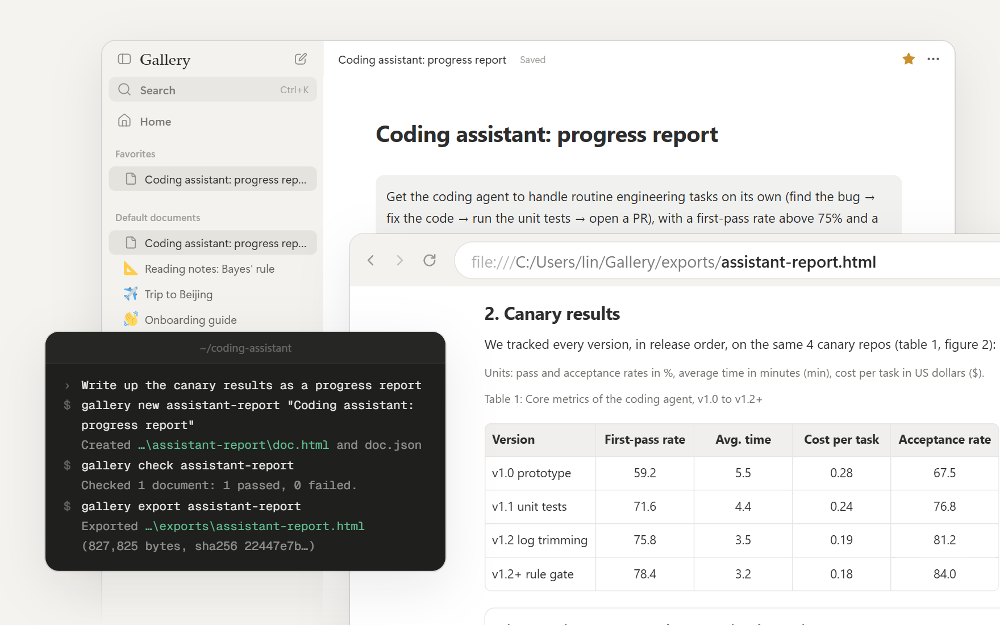
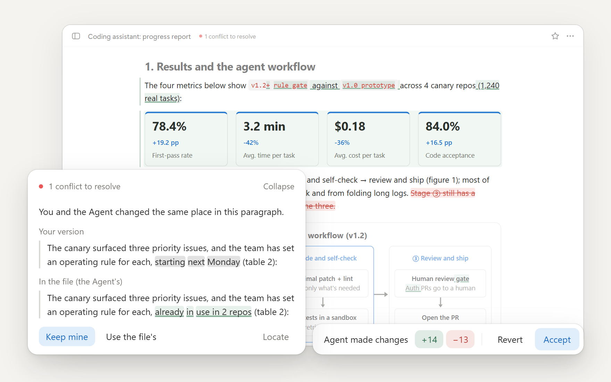
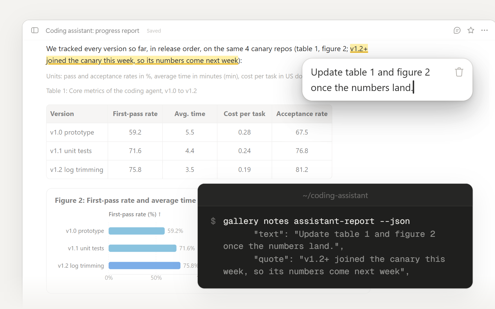
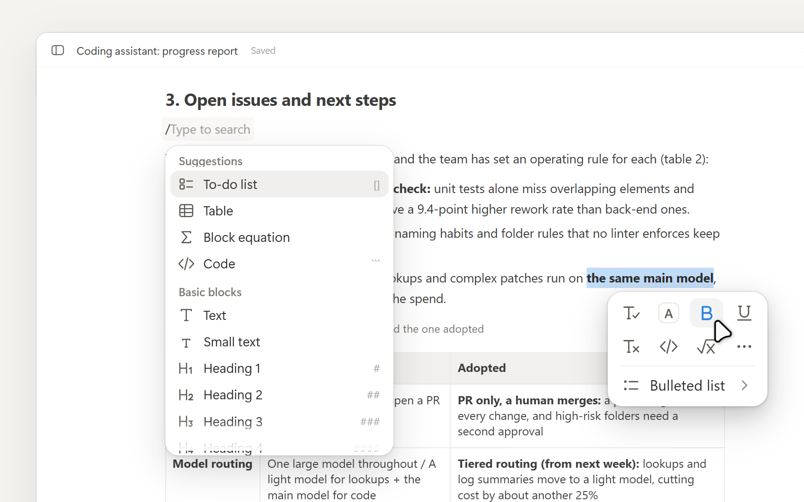
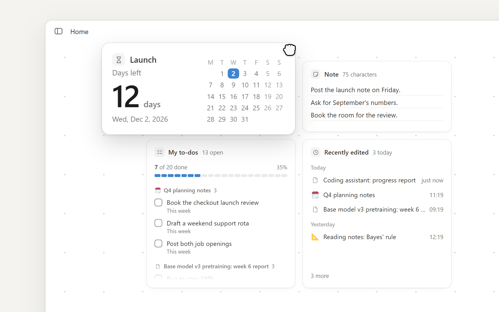

<p align="center">
  <picture>
    <source media="(prefers-color-scheme: dark)" srcset=".github/readme/wordmark-dark.png">
    
  </picture>
</p>

<h3 align="center">Write HTML documents with your agent</h3>

<p align="center">
  Gallery is a document editor that runs on your computer: while an agent writes an HTML document, you can edit it directly, the way you would in Notion.
</p>

<p align="center">
  <a href="https://www.npmjs.com/package/@heycys/gallery"></a>
  <a href="LICENSE"></a>
</p>

<p align="center">
  <b>English</b> · <a href="docs/i18n/README.zh-CN.md">简体中文</a> · <a href="docs/i18n/README.zh-TW.md">繁體中文</a> · <a href="docs/i18n/README.ja.md">日本語</a> · <a href="docs/i18n/README.ko.md">한국어</a> · <a href="docs/i18n/README.es.md">Español</a>
</p>

<p align="center">
  <picture>
    <source media="(prefers-color-scheme: dark)" srcset=".github/readme/hero-dark.webp">
    
  </picture>
</p>

<!-- The online demo (once it is deployed): <p align="center"><sub><a href="https://heycys.github.io/gallery/">Open an exported document online</a></sub></p> -->

## Why Gallery

Ask an agent to write a document and you often run into the same problem. Have it **write Markdown**, and there is no place for an interactive chart. Have it **write HTML**, and changing anything yourself is a chore. Use an **online document**, and a local agent can't read and write it with the file tools it knows.

What Gallery does about it:

- It puts a Notion-style editor on top of the HTML file the agent writes.
- The agent writes `doc.html` directly, and you edit the same document the way you would in Notion. Neither gets in the other's way.
- Gallery merges the two sides by itself, marks what the agent changed, and waits for you where the two conflict.
- When the document is done, export it as a standalone HTML file (or another format) that anyone can open.

<p align="center">
  <picture>
    <source media="(prefers-color-scheme: dark)" srcset=".github/readme/flow-dark.png">
    
  </picture>
</p>

## Quick start

```bash
npm i -g @heycys/gallery
gallery skill install
```

The second command installs the companion skill into Claude Code (`~/.claude/skills/gallery`) and Codex (`~/.codex/skills/gallery`), whichever you have. Then just tell your agent:

> Use Gallery to turn the material and data in `./research` into a report, with a summary of the conclusions, a comparison table and a trend chart.

**What happens next:**

1. The agent reads your standing writing preferences (the workspace's `preferences/`), runs `gallery new` to create the document, and sends you its local address.
2. Once the page is open in your browser, whatever the agent saves appears on it right away. You can write, rearrange, or select some text and leave a note at any time.
3. When the document is done, the agent runs `gallery export` to write a single file, checks the layout of the result itself with `gallery qa`, and hands the document to you.

**Other ways to start:**

- **Download the skill and let your agent install it.** Get `gallery-skill-<version>.zip` from [Releases](https://github.com/heycys/gallery/releases), send it to your agent and ask it to install it.
- **Look around the workbench first.** Run `gallery open`, or bring in a document you already have with `gallery import ./notes.md` (Markdown, Word, PDF, HTML, CSV, EPUB and Notion export ZIPs).
- **Things to say next:** *"Revise it by my notes, update the chart's data, and keep the conclusions I edited."* · *"Make me a home page with my to-dos, recent documents and a launch countdown."*

**Requirements:** Node.js `22.13` or newer. Editing in the browser and `gallery qa` need desktop **Chrome** or **Microsoft Edge** (other browsers are untested; verified so far on Windows 11 and macOS 27).

## How it works

The workspace is `~/Documents/Gallery` by default (name another with `--workspace` or `GALLERY_WORKSPACE`). Every document is an ordinary folder:

```text
~/Documents/Gallery/
├── preferences/                # your standing writing preferences; the agent reads them before it writes
├── release-review/
│   ├── doc.html                # the one source of the document (shared by the agent, the editor and Git)
│   ├── doc.json                # title, description, icon and page settings
│   ├── annotations.json        # your notes on text and blocks (never in the document or the export)
│   └── assets/                 # images and attachments
├── components/ & pages/        # reusable custom blocks and canvas pages (the home page is one)
└── exports/
    └── release-review.html     # the single offline HTML file you hand over
```

`doc.html` is standard, plain-text HTML on your disk, so your agent, Git and any editor can read and write it. Change a sentence on the page and Gallery rewrites only the lines that hold it, leaving every other byte as it was, so `git diff` can be reviewed line by line. (One exception: tables, toggles, code and math that the agent wrote as plain HTML are rewritten in Gallery's form the first time the document is saved or exported.)

## Features

### Both of you write at once, without interruption

When the agent writes to the file, what it wrote appears in place on the page. Your cursor, selection and undo history stay as they were. Gallery merges the two sides block by block.

What the agent added is marked in green, and what it deleted is shown in red, struck through. A bar at the bottom lets you **Accept** or **Revert** its changes. Every version in **Version history** can be restored.

<picture>
  <source media="(prefers-color-scheme: dark)" srcset=".github/readme/review-dark.png">
  
</picture>

If you and the agent both changed the same spot, a card lets you choose. **No text is lost.** If the agent rewrites the whole file from an old copy and undoes something you just saved, you get a card too. Gallery does all it can not to lose a word by accident.

### Leave notes, hand them back

Select text or a block and write what you want changed. The agent reads the notes itself with `gallery notes`. Notes are kept next to the document in `annotations.json`, so they never end up in the document or the exported file.

<picture>
  <source media="(prefers-color-scheme: dark)" srcset=".github/readme/notes-dark.png">
  
</picture>

### The expressiveness of HTML, edited like Notion

- **A block editor you can use at once:** drag handles, the `/` menu (with a Chinese input method `、` opens it too; type letters to filter), Markdown shortcuts, selection across blocks, and pasting straight from Notion and Feishu.
- **Far denser than Markdown:** tables with merged cells and sorting, KaTeX math, Shiki code highlighting, toggle lists, tabs, callouts, detail cards, step flowcharts, web bookmarks and embeds are all built in.
- **Free-form figures and custom blocks:** the agent can draw an interactive figure in D3 for the data at hand, or write a custom whole block with styles of its own for a special layout. On the page you can still move it as one block and edit the words in it.

<picture>
  <source media="(prefers-color-scheme: dark)" srcset=".github/readme/editing-dark.png">
  
</picture>

### Make the home page your own

The home page is a canvas of cards you can drag and resize: notes, to-dos, a countdown, a habit tracker, recently edited documents, an edit heatmap, the weather. Ask your agent for a card that isn't there and it builds one with `gallery block`, or a whole page with `gallery page`. For example:

> Design a progress card for my home page where I can change this week's target and how many are done.

<picture>
  <source media="(prefers-color-scheme: dark)" srcset=".github/readme/home-dark.png">
  
</picture>

## Common commands

Everything you can do in the workbench (create, move, rename, favorite, trash, version history, notes, export and so on) has an equivalent `gallery` command, so an agent never has to click through the interface with browser automation:

| Command | What it does |
| --- | --- |
| `gallery open [<slug>]` | Starts the local server (it listens on `127.0.0.1` only) and opens the workbench, or one document, in your default browser |
| `gallery new <slug> "<title>"` | Creates a document, starts the local server and prints the document's address |
| `gallery import <file>` | Turns Markdown, HTML, Word, PDF, CSV, EPUB or a ZIP (Notion exports included) into documents |
| `gallery list [--tree] [--all]` | Lists or searches the workspace's documents and their tree (`--json` too) |
| `gallery notes <slug>` | Shows a document's notes, marks them done or removes them |
| `gallery history <slug>` / `revert` | Shows earlier versions and restores one, or takes back the agent's changes you have not accepted |
| `gallery check [<slug>...]` | A read-only check of a document's structure, assets, placeholder content and inline scripts |
| `gallery export <slug>...` | Normalizes the markup, runs the check and writes the single offline file `exports/<slug>.html` (also `--format pdf\|markdown`) |
| `gallery qa <slug>...` | Opens the export at `1024`, `736` and `360px` wide, reports layout problems and takes pictures of the changed blocks |
| `gallery block` / `gallery page` | Creates, installs, checks and tests custom blocks, block packs and custom canvas pages |
| `gallery doctor` | Checks the Node version, the installed skill, the workspace's permissions and the local browser |

For every option, run `gallery help` or see the [user manual](docs/manual.zh-CN.md) (Chinese for now).

<details>
<summary><b>And also</b></summary>
<br>

- **Writing preferences.** Your standing rules for the agent (what to write, in what order, how to title things) live in the workspace. The agent reads them before it writes.
- **A dot when something changed.** When your agent updates a page you aren't looking at, a blue dot appears next to it in the sidebar.
- **Workbench.** Document tree with drag-to-nest, favorites, full-text search, trash, several workspaces, presentation view. Light and dark themes; the interface is in English and Chinese.
- **Extensions.** Add panels and settings to the workbench, with a backend of their own.

</details>

## Good to know

- **It runs only on your computer.** The server listens on 127.0.0.1, so only this computer can reach it. There is no account and no cloud; the only thing that calls a language model is your own agent. Bookmarks, embeds and online cards such as the weather go online, and cards ask first. Once a day, in the background, `gallery` also asks the npm registry (the one your npm uses) whether there is a newer version; `GALLERY_NO_UPDATE_CHECK=1` turns that off. Installed with `npm i -g` on Windows or macOS, Gallery starts its server when you log in; turn that off with **Start at login** in **Settings**, or with `gallery startup disable`.
- **"Together" means you and your agent.** Gallery has no cloud sync and no multi-user editing. Let one agent write a document at a time.
- **Documents run their own scripts.** Open documents that you or your own agent wrote.
- **Tested so far:** Windows 11 with Chrome and Edge, and macOS 27 with Chrome. Linux, Safari, Firefox and touch devices are untested, and Chinese input methods have been tested by simulation only.
- **The pictures on this page** show the product's real pages: every picture at rest is a state the product was really in, and the motion between them is replayed frame by frame. The arrangement was made afterwards: where the windows sit, the enlarged pieces laid over them, the request box at the start of the first picture, the terminal windows (their commands and output are real), the browser's address bar and the pointer. The documents and the home page in them hold sample data.

## How it's tested

Merging two writers into one file is the part that has to be right, so it gets the most testing:

- over 700 scenarios that drive a real Chrome, including simulated input-method typing;
- randomized runs in which a person and an agent take turns editing the same document: the file and the page must agree, and every character either ends up in the file or is listed for you to copy;
- before every release, the packed build is installed and every command is run once.

## For agents

If you are an agent reading this: install Gallery with the two commands under [Quick start](#quick-start), then read [`SKILL.md`](skills/gallery/SKILL.md) and follow it.

## More

- [User manual](docs/manual.zh-CN.md) (Chinese for now) · [`SKILL.md`](skills/gallery/SKILL.md) · [Maintainer docs](docs/internals.md) · [Releases](https://github.com/heycys/gallery/releases)
- **Contributing.** The most useful help right now is trying Gallery on macOS or Linux, or in Safari and Firefox, and [reporting what you see](https://github.com/heycys/gallery/issues). For bugs, include your OS, browser, Node version and Gallery version. To work on the code, start with [CONTRIBUTING.md](.github/CONTRIBUTING.md).
- **License.** [MIT](LICENSE). What the repository holds of others' work (the emoji pictures and data, the icon sets) is listed with its licences in [THIRD-PARTY-NOTICES.md](THIRD-PARTY-NOTICES.md).
