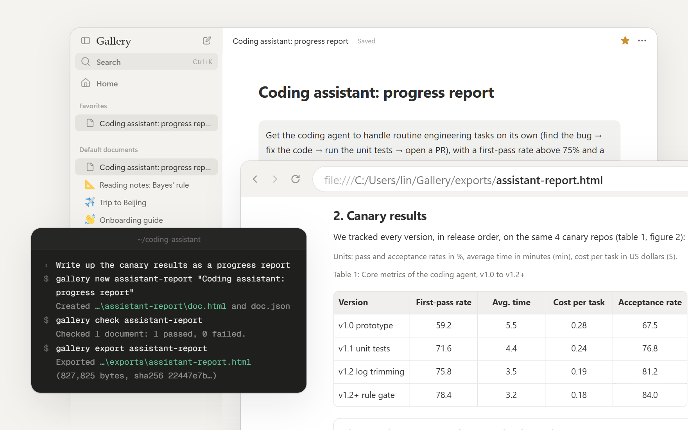
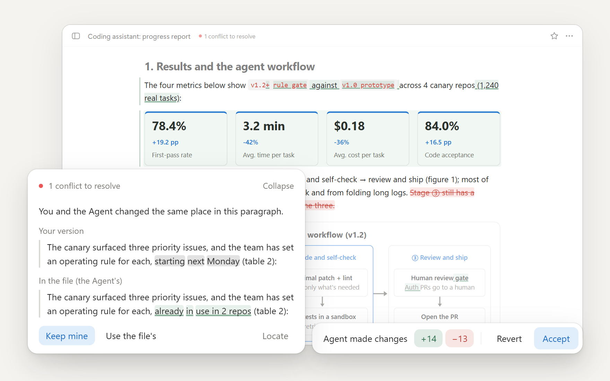
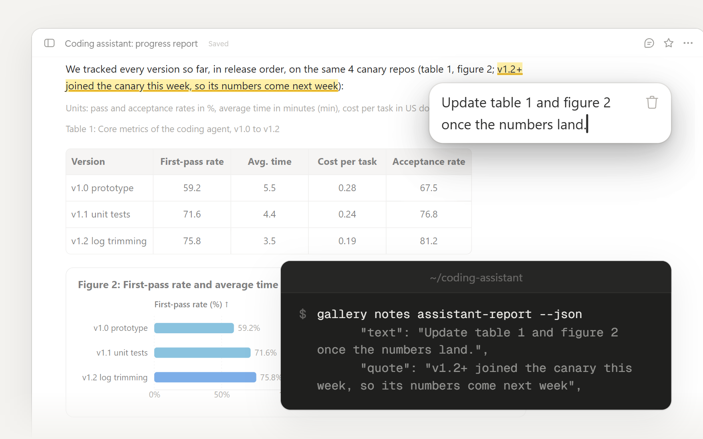
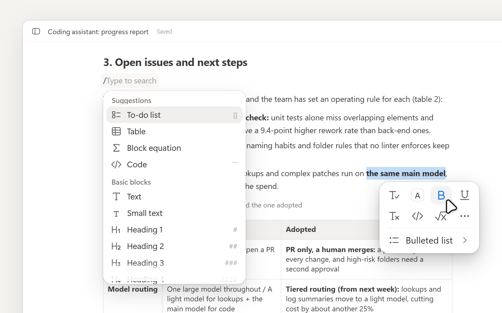
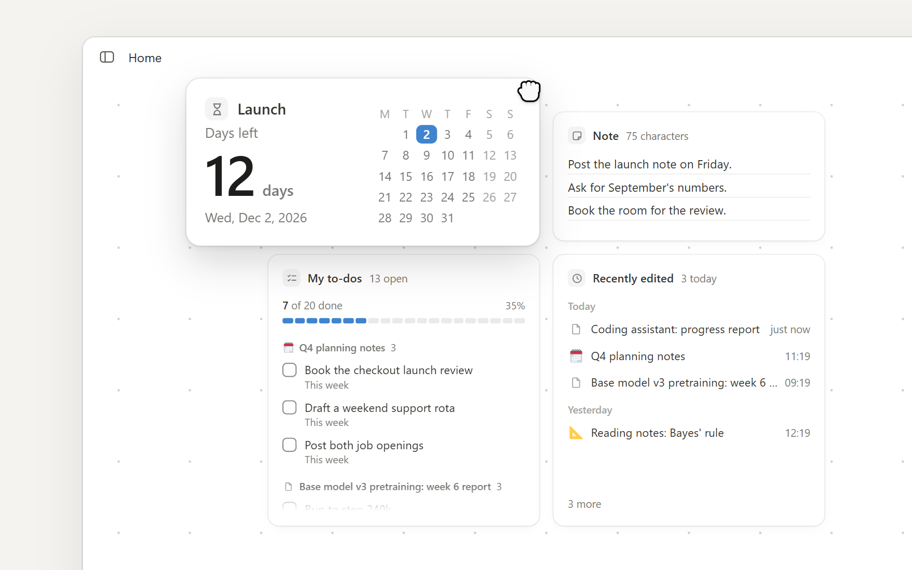

<p align="center">
  <picture>
    <source media="(prefers-color-scheme: dark)" srcset="../../.github/readme/wordmark-dark.png">
    
  </picture>
</p>

<h3 align="center">Escribe documentos HTML con tu agente</h3>

<p align="center">
  Un editor local en el que puedes editar directamente, como en Notion, los documentos HTML que escribe tu agente de programación.
</p>

<p align="center">
  <a href="https://www.npmjs.com/package/@heycys/gallery"></a>
  <a href="../../LICENSE"></a>
</p>

<p align="center">
  <a href="../../README.md">English</a> · <a href="README.zh-CN.md">简体中文</a> · <a href="README.zh-TW.md">繁體中文</a> · <a href="README.ja.md">日本語</a> · <a href="README.ko.md">한국어</a> · <b>Español</b>
</p>

<p align="center">
  <picture>
    <source media="(prefers-color-scheme: dark)" srcset="../../.github/readme/hero-dark.webp">
    
  </picture>
</p>

<!-- La demo en línea (cuando esté desplegada): <p align="center"><sub><a href="https://heycys.github.io/gallery/">Abrir en línea un documento exportado</a></sub></p> -->

## Por qué Gallery

Cuando le pides a un agente que escriba un documento, suele aparecer el mismo problema. Si le pides que **escriba Markdown**, no hay sitio para un gráfico interactivo. Si le pides que **escriba HTML**, cambiar cualquier cosa por tu cuenta resulta tedioso. Si usas un **documento en línea**, un agente local no puede leerlo ni escribirlo con las herramientas de archivos que conoce.

Lo que hace Gallery al respecto:

- Pone un editor al estilo de Notion encima del archivo HTML que escribe el agente.
- El agente escribe `doc.html` directamente, y tú editas el mismo documento como lo harías en Notion. Ninguno estorba al otro.
- Gallery combina los dos lados por su cuenta, marca qué cambió el agente y, donde los dos chocan, espera a que decidas tú.
- Cuando el documento está terminado, lo exportas como un archivo HTML independiente (u otro formato) que cualquiera puede abrir.

<p align="center">
  <picture>
    <source media="(prefers-color-scheme: dark)" srcset="../../.github/readme/flow-dark.png">
    
  </picture>
</p>

## Inicio rápido

```bash
npm i -g @heycys/gallery
gallery skill install
```

El segundo comando instala la skill complementaria en Claude Code (`~/.claude/skills/gallery`) y en Codex (`~/.codex/skills/gallery`), en el que tengas instalado o en los dos. Después, basta con decirle a tu agente:

> Usa Gallery para convertir el material y los datos de `./research` en un informe, con un resumen de las conclusiones, una tabla comparativa y un gráfico de tendencia.

**Qué pasa después:**

1. El agente lee tus preferencias de escritura permanentes (la carpeta `preferences/` del espacio de trabajo), ejecuta `gallery new` para crear el documento y te envía su dirección local.
2. Con la página abierta en el navegador, todo lo que el agente guarda aparece en ella al instante. Tú puedes escribir, reorganizar o seleccionar un texto y dejar una nota en cualquier momento.
3. Cuando el documento está terminado, el agente ejecuta `gallery export` para escribir un único archivo, revisa él mismo la maquetación del resultado con `gallery qa` y te entrega el documento.

**Otras formas de empezar:**

- **Descarga la skill y deja que tu agente la instale.** Descarga `gallery-skill-<version>.zip` desde [Releases](https://github.com/heycys/gallery/releases), envíaselo a tu agente y pídele que lo instale.
- **Echa primero un vistazo al entorno de trabajo.** Ejecuta `gallery open`, o trae un documento que ya tengas con `gallery import ./notes.md` (Markdown, Word, PDF, HTML, CSV, EPUB y archivos ZIP exportados de Notion).
- **Lo siguiente que puedes pedirle:** *«Revísalo según mis notas, actualiza los datos del gráfico y conserva las conclusiones que edité.»* · *«Hazme una página de inicio con mis tareas, los documentos recientes y una cuenta regresiva para el lanzamiento.»*

**Requisitos:** Node.js `22.13` o posterior. Para editar en el navegador y para `gallery qa` hace falta **Chrome** o **Microsoft Edge** de escritorio (otros navegadores no se han probado; hasta ahora se ha verificado en Windows 11 y macOS 27).

## Cómo funciona

El espacio de trabajo es `~/Documents/Gallery` por defecto (puedes indicar otro con `--workspace` o `GALLERY_WORKSPACE`). Cada documento es una carpeta normal:

```text
~/Documents/Gallery/
├── preferences/                # tus preferencias de escritura permanentes; el agente las lee antes de escribir
├── release-review/
│   ├── doc.html                # la única fuente del documento (la comparten el agente, el editor y Git)
│   ├── doc.json                # título, descripción, icono y ajustes de página
│   ├── annotations.json        # tus notas sobre textos y bloques (nunca van al documento ni a la exportación)
│   └── assets/                 # imágenes y archivos adjuntos
├── components/ & pages/        # bloques personalizados reutilizables y páginas de lienzo (la página de inicio es una)
└── exports/
    └── release-review.html     # el único archivo HTML sin conexión que entregas
```

`doc.html` es HTML estándar, en texto plano, guardado en tu disco, así que tu agente, Git y cualquier editor pueden leerlo y escribirlo. Si cambias una frase en la página, Gallery reescribe solo las líneas que la contienen y deja todos los demás bytes como estaban, de modo que `git diff` se puede revisar línea por línea. (Una excepción: las tablas, los desplegables, el código y las fórmulas matemáticas que el agente escribió como HTML simple se reescriben en el formato de Gallery la primera vez que se guarda o se exporta el documento.)

## Funciones

### Escribir los dos a la vez, sin interrupciones

Cuando el agente escribe en el archivo, lo que escribió aparece en su sitio en la página. Tu cursor, tu selección y tu historial de deshacer se quedan como estaban. Gallery combina los dos lados bloque por bloque.

Lo que el agente añadió se marca en verde, y lo que eliminó se muestra en rojo, tachado. Una barra en la parte inferior te permite **Accept** (aceptar) o **Revert** (revertir) sus cambios. Cualquier versión de **Version history** (historial de versiones) se puede restaurar.

<picture>
  <source media="(prefers-color-scheme: dark)" srcset="../../.github/readme/review-dark.png">
  
</picture>

Si tú y el agente cambian el mismo punto, una tarjeta te deja elegir. **No se pierde ningún texto.** Si el agente reescribe todo el archivo a partir de una copia antigua y deshace algo que acabas de guardar, también aparece una tarjeta. Gallery hace todo lo posible para no perder ni una palabra por accidente.

### Dejar notas y devolvérselas al agente

Selecciona un texto o un bloque y escribe qué quieres cambiar. El agente lee las notas por su cuenta con `gallery notes`. Las notas se guardan junto al documento, en `annotations.json`, así que nunca acaban dentro del documento ni del archivo exportado.

<picture>
  <source media="(prefers-color-scheme: dark)" srcset="../../.github/readme/notes-dark.png">
  
</picture>

### La expresividad de HTML, editada como en Notion

- **Un editor de bloques que puedes usar desde el primer momento:** asas para arrastrar, el menú `/` (con un método de entrada chino también se abre con `、`; escribe letras para filtrar), atajos de Markdown, selección de un bloque a otro y pegado directo desde Notion y Feishu.
- **Mucho más denso que Markdown:** vienen integradas tablas con celdas combinadas y ordenación, fórmulas con KaTeX, resaltado de código con Shiki, listas desplegables, pestañas, cuadros destacados, tarjetas de detalle, diagramas de flujo por pasos, marcadores web y contenido incrustado.
- **Gráficos libres y bloques personalizados:** el agente puede dibujar con D3 un gráfico interactivo pensado para los datos concretos, o escribir un bloque completo a medida, con estilos propios, para una maquetación especial. En la página puedes seguir moviéndolo como un solo bloque y editar el texto que contiene.

<picture>
  <source media="(prefers-color-scheme: dark)" srcset="../../.github/readme/editing-dark.png">
  
</picture>

### Personalizar tu página de inicio

La página de inicio es un lienzo de tarjetas que puedes arrastrar y cambiar de tamaño: notas, tareas, una cuenta regresiva, un seguimiento de hábitos, documentos editados recientemente, un mapa de calor de ediciones, el clima. Pídele a tu agente una tarjeta que no exista y la crea con `gallery block`, o una página entera con `gallery page`. Por ejemplo:

> Diseña para mi página de inicio una tarjeta de progreso en la que pueda cambiar el objetivo de esta semana y cuántos llevo hechos.

<picture>
  <source media="(prefers-color-scheme: dark)" srcset="../../.github/readme/home-dark.png">
  
</picture>

## Comandos habituales

Todo lo que puedes hacer en el entorno de trabajo (crear, mover, renombrar, marcar como favorito, enviar a la papelera, historial de versiones, notas, exportar, etc.) tiene su comando `gallery` equivalente, así que un agente nunca tiene que recorrer la interfaz a clics mediante automatización del navegador:

| Comando | Qué hace |
| --- | --- |
| `gallery open [<slug>]` | Inicia el servidor local (solo escucha en `127.0.0.1`) y abre el entorno de trabajo, o un documento, en tu navegador predeterminado |
| `gallery new <slug> "<title>"` | Crea un documento, inicia el servidor local y muestra la dirección del documento |
| `gallery import <file>` | Convierte Markdown, HTML, Word, PDF, CSV, EPUB o un ZIP (incluidas las exportaciones de Notion) en documentos |
| `gallery list [--tree] [--all]` | Lista o busca los documentos del espacio de trabajo y su árbol (también con `--json`) |
| `gallery notes <slug>` | Muestra las notas de un documento, las marca como hechas o las elimina |
| `gallery history <slug>` / `revert` | Muestra versiones anteriores y restaura una, o deshace los cambios del agente que aún no has aceptado |
| `gallery check [<slug>...]` | Comprobación de solo lectura de la estructura de un documento, sus recursos, el contenido provisional y los scripts en línea |
| `gallery export <slug>...` | Normaliza el marcado, ejecuta la comprobación y escribe el archivo único sin conexión `exports/<slug>.html` (también `--format pdf\|markdown`) |
| `gallery qa <slug>...` | Abre el archivo exportado con `1024`, `736` y `360px` de ancho, informa de los problemas de maquetación y hace capturas de los bloques modificados |
| `gallery block` / `gallery page` | Crea, instala, comprueba y prueba bloques personalizados, paquetes de bloques y páginas de lienzo personalizadas |
| `gallery doctor` | Comprueba la versión de Node, la skill instalada, los permisos del espacio de trabajo y el navegador local |

Para ver todas las opciones, ejecuta `gallery help` o consulta el [manual de usuario](../manual.zh-CN.md) (por ahora, en chino).

<details>
<summary><b>Y además</b></summary>
<br>

- **Writing preferences** (preferencias de escritura). Tus reglas permanentes para el agente (qué escribir, en qué orden, cómo poner los títulos) se guardan en el espacio de trabajo. El agente las lee antes de escribir.
- **Un punto cuando algo cambia.** Cuando tu agente actualiza una página que no estás mirando, aparece un punto azul junto a ella en la barra lateral.
- **Entorno de trabajo.** Árbol de documentos con anidado por arrastre, favoritos, búsqueda de texto completo, papelera, varios espacios de trabajo, vista de presentación. Temas claro y oscuro; la interfaz está en inglés y chino.
- **Extensiones.** Añade paneles y ajustes al entorno de trabajo, con un backend propio.

</details>

## Conviene saber

- **Se ejecuta solo en tu equipo.** El servidor escucha en 127.0.0.1, así que solo este equipo puede acceder a él. No hay cuenta ni nube; lo único que llama a un modelo de lenguaje es tu propio agente. Los marcadores web, los contenidos incrustados y las tarjetas en línea, como la del clima, se conectan a internet, y las tarjetas preguntan antes. Además, una vez al día y en segundo plano, `gallery` pregunta al registro de npm (el que usa tu npm) si hay una versión nueva; `GALLERY_NO_UPDATE_CHECK=1` lo desactiva. Si lo instalas con `npm i -g` en Windows o macOS, Gallery arranca su servidor cuando inicias sesión; puedes desactivarlo con **Start at login** (arrancar al iniciar sesión) en **Settings** (ajustes), o con `gallery startup disable`.
- **«Juntos» significa tú y tu agente.** Gallery no tiene sincronización en la nube ni edición multiusuario. Deja que un solo agente escriba un documento a la vez.
- **Los documentos ejecutan sus propios scripts.** Abre documentos escritos por ti o por tu propio agente.
- **Probado hasta ahora:** Windows 11 con Chrome y Edge, y macOS 27 con Chrome. Linux, Safari, Firefox y los dispositivos táctiles no se han probado, y la escritura con un método de entrada (IME) se ha probado solo mediante simulación.
- **Las imágenes de esta página** muestran páginas reales del producto: cada imagen en reposo es un estado en el que el producto estuvo de verdad, y el movimiento entre esos estados se reproduce fotograma a fotograma. La composición se hizo después: dónde se colocan las ventanas, las partes ampliadas superpuestas, el cuadro de la petición al comienzo de la primera imagen, las ventanas de terminal (sus comandos y su salida son reales), la barra de direcciones del navegador y el puntero. Los documentos y la página de inicio que aparecen en ellas contienen datos de ejemplo.

## Cómo se prueba

Combinar en un solo archivo lo que escriben dos autores es la parte que tiene que salir bien, por eso es la que más pruebas recibe:

- más de 700 escenarios que controlan un Chrome real, incluida la escritura simulada con un método de entrada;
- ejecuciones aleatorias en las que una persona y un agente se turnan para editar el mismo documento: el archivo y la página deben coincidir, y cada carácter acaba en el archivo o aparece en una lista para que lo copies;
- antes de cada versión, una prueba de instalación del paquete de lanzamiento en la que se ejecuta cada comando una vez.

## Para agentes

Si eres un agente y estás leyendo esto: instala Gallery con los dos comandos de [Inicio rápido](#inicio-rápido), luego lee [`SKILL.md`](../../skills/gallery/SKILL.md) y síguelo.

## Más

- [Manual de usuario](../manual.zh-CN.md) (por ahora, en chino) · [`SKILL.md`](../../skills/gallery/SKILL.md) · [Documentación para mantenedores](../internals.md) (en inglés) · [Releases](https://github.com/heycys/gallery/releases)
- **Contribuir.** La ayuda más útil ahora mismo es probar Gallery en macOS o Linux, o en Safari y Firefox, y [contarnos lo que veas](https://github.com/heycys/gallery/issues). Si se trata de un error, incluye tu sistema operativo, tu navegador y las versiones de Node y de Gallery. Para trabajar en el código, empieza por [CONTRIBUTING.md](../../.github/CONTRIBUTING.md) (en inglés).
- **Licencia.** [MIT](../../LICENSE). Lo que el repositorio contiene de otros autores (las imágenes y los datos de los emojis, los conjuntos de iconos) figura con sus licencias en [THIRD-PARTY-NOTICES.md](../../THIRD-PARTY-NOTICES.md) (en inglés).
