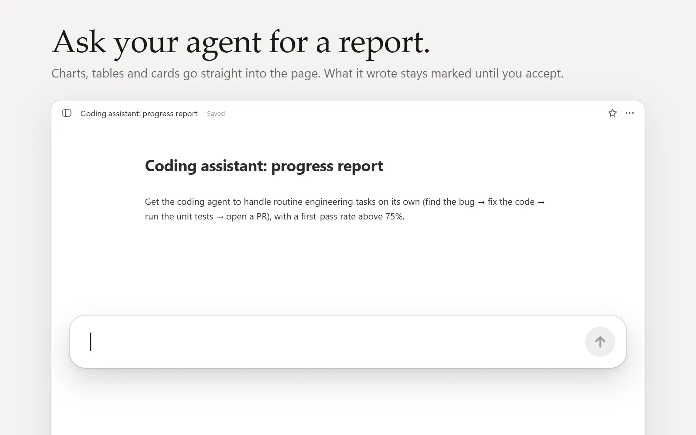
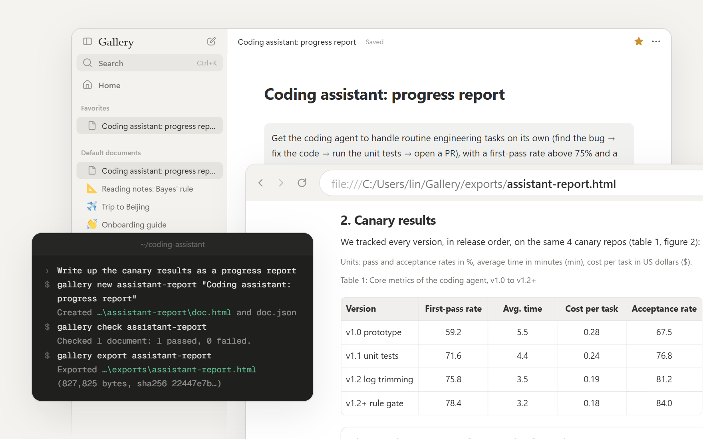
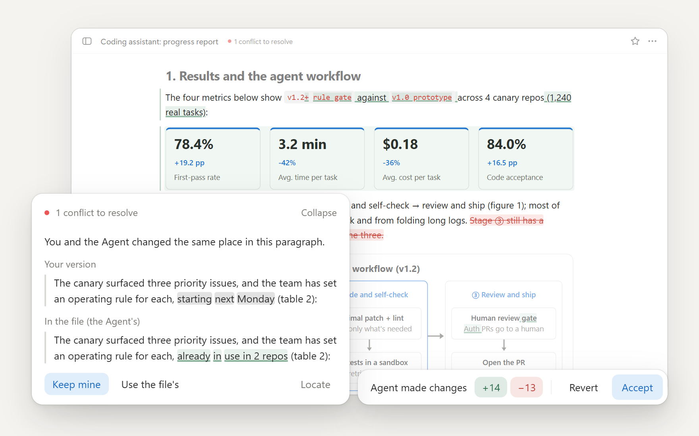
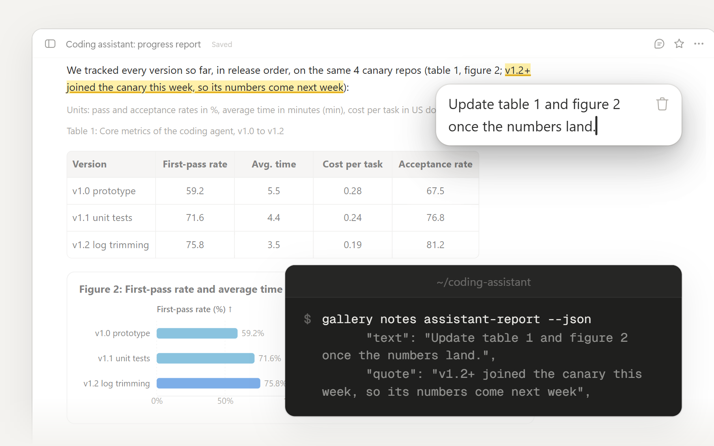
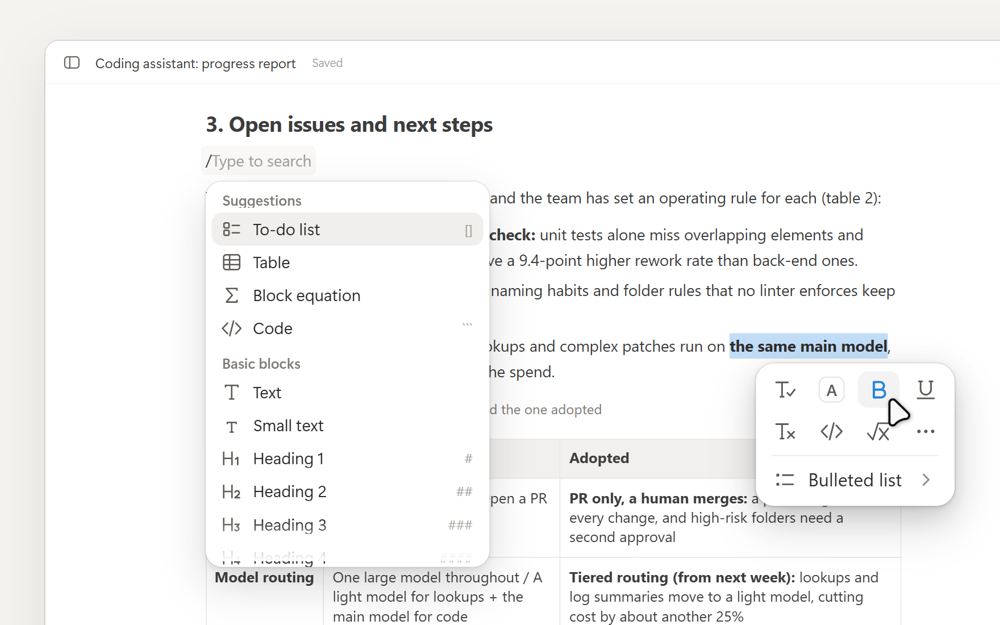
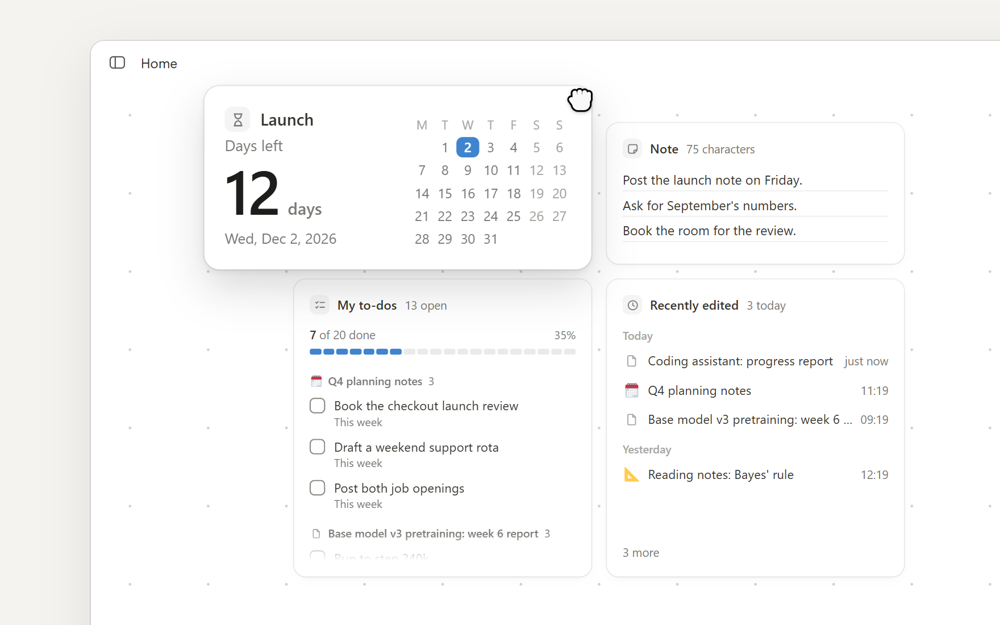

<p align="center">
  <picture>
    <source media="(prefers-color-scheme: dark)" srcset="../../.github/readme/wordmark-dark.png">
    
  </picture>
</p>

<h3 align="center">エージェントと一緒に HTML ドキュメントを書く</h3>

<p align="center">
  コーディングエージェントが書く HTML ドキュメントを、Notion のようにそのまま編集できる、ローカルのエディターです。
</p>

<p align="center">
  <a href="https://www.npmjs.com/package/@heycys/gallery"></a>
  <a href="../../LICENSE"></a>
</p>

<p align="center">
  <a href="../../README.md">English</a> · <a href="README.zh-CN.md">简体中文</a> · <a href="README.zh-TW.md">繁體中文</a> · <b>日本語</b> · <a href="README.ko.md">한국어</a> · <a href="README.es.md">Español</a>
</p>

<p align="center">
  <picture>
    <source media="(prefers-color-scheme: dark)" srcset="../../.github/readme/hero-dark.webp">
    
  </picture>
</p>

<!-- オンラインデモ（公開してから入れる）：<p align="center"><sub><a href="https://heycys.github.io/gallery/">書き出したドキュメントをオンラインで開く</a></sub></p> -->

## なぜ Gallery なのか

エージェントにドキュメントを書いてもらうと、よく同じ問題にぶつかります。**Markdown で書かせる**と、インタラクティブなグラフを置く場所がありません。**HTML で書かせる**と、自分で少し直すだけでも手間がかかります。**オンラインのドキュメント**を使うと、ローカルのエージェントが使い慣れたファイルツールで読み書きできません。

そこで Gallery は、次のようにします。

- エージェントが書く HTML ファイルの上に、Notion 風のエディターを載せます。
- エージェントは `doc.html` を直接書き、あなたは同じドキュメントを Notion と同じように編集します。互いの邪魔にはなりません。
- Gallery は 2 者の変更を自動で 1 つに合わせ、エージェントが何を変えたかを示し、両者がぶつかったところではあなたの判断を待ちます。
- できあがったドキュメントは、誰でも開ける単体の HTML ファイル（またはほかの形式）に書き出せます。

<p align="center">
  <picture>
    <source media="(prefers-color-scheme: dark)" srcset="../../.github/readme/flow-dark.png">
    
  </picture>
</p>

## クイックスタート

```bash
npm i -g @heycys/gallery
gallery skill install
```

2 つ目のコマンドで、付属のスキルを Claude Code（`~/.claude/skills/gallery`）と Codex（`~/.codex/skills/gallery`）のうち、入っているものにインストールします。あとは、エージェントにこう伝えるだけです。

> Gallery を使って、`./research` の資料とデータを、結論の要約、比較表、推移グラフの入ったレポートにまとめてください。

**このあとの流れ：**

1. エージェントはまず、あらかじめ決めておいた書き方の設定（ワークスペースの `preferences/`）を読み、`gallery new` でドキュメントを作って、そのローカルのアドレスを送ってきます。
2. ブラウザーでページを開いておくと、エージェントが保存するたびに、その内容がすぐにページに現れます。あなたはいつでも書いたり、並べ替えたり、文字を選んでメモを残したりできます。
3. できあがると、エージェントは `gallery export` で 1 つのファイルに書き出し、`gallery qa` で仕上がりのレイアウトを自分で確かめてから、ドキュメントをあなたに渡します。

**ほかの始め方：**

- **スキルをダウンロードして、エージェントにインストールしてもらう。** [Releases](https://github.com/heycys/gallery/releases) から `gallery-skill-<version>.zip` を入手し、エージェントに渡してインストールを頼みます。
- **まずワークベンチを見てみる。** `gallery open` を実行するか、手元のドキュメントを `gallery import ./notes.md` で取り込みます（Markdown、Word、PDF、HTML、CSV、EPUB、Notion のエクスポート ZIP に対応）。
- **次に頼めること：** *「私のメモのとおりに直して、グラフのデータを更新してください。私が編集した結論はそのままにしてください。」* · *「ToDo、最近のドキュメント、リリースまでのカウントダウンを置いたホーム画面を作ってください。」*

**動作環境：** Node.js `22.13` 以降。編集にはデスクトップ版の **Chrome**、**Microsoft Edge**、または **macOS の Safari** が使えます。`gallery qa` には Chrome または Edge が必要です。

## 仕組み

ワークスペースの既定の場所は `~/Documents/Gallery` です（`--workspace` か `GALLERY_WORKSPACE` で別の場所を指定できます）。ドキュメントはそれぞれ、普通のフォルダーになっています。

```text
~/Documents/Gallery/
├── preferences/                # あらかじめ決めておいた書き方の設定。エージェントは書く前にこれを読む
├── release-review/
│   ├── doc.html                # ドキュメントの唯一のソース（エージェント、エディター、Git が共有）
│   ├── doc.json                # タイトル、説明、アイコン、ページの設定
│   ├── annotations.json        # 文字やブロックに付けたメモ（ドキュメントにも書き出しにも入らない）
│   └── assets/                 # 画像と添付ファイル
├── components/ & pages/        # 再利用できるカスタムブロックとキャンバスページ（ホーム画面もその 1 つ）
└── exports/
    └── release-review.html     # 渡すための、オフラインで開ける単一の HTML ファイル
```

`doc.html` はディスク上の標準的なプレーンテキストの HTML なので、エージェントも Git もどんなエディターも読み書きできます。ページ上で一文を変えると、Gallery はその文がある行だけを書き換え、ほかのバイトは元のまま残すので、`git diff` を 1 行ずつ確認できます。（例外が 1 つあります。エージェントが普通の HTML で書いた表、トグル、コード、数式は、最初に保存または書き出したときに Gallery の形式に書き換えられます。）

## 機能

### 同時に書いても、作業は止まらない

エージェントがファイルに書き込むと、書いた内容がページのその場に現れます。あなたのカーソル、選択範囲、元に戻す履歴はそのままです。Gallery は 2 者の変更をブロックごとに合わせます。

エージェントが追加した部分は緑色で、削除した部分は赤い取り消し線つきで示されます。下部のバーで、その変更を **Accept**（受け入れる）か **Revert**（取り消す）かを選べます。**Version history**（バージョン履歴）では、どのバージョンも復元できます。

<picture>
  <source media="(prefers-color-scheme: dark)" srcset="../../.github/readme/review-dark.png">
  
</picture>

あなたとエージェントが同じ箇所を変更した場合は、カードで選べます。**文字は失われません**。エージェントが古いコピーをもとにファイル全体を書き直し、あなたが保存したばかりの変更を元に戻してしまった場合も、カードが出ます。Gallery は、文字がうっかり失われることのないよう、できる限りのことをします。

### メモを残して、エージェントに返す

文字かブロックを選び、直してほしいことを書きます。エージェントは `gallery notes` で自分でメモを読みます。メモはドキュメントの隣の `annotations.json` に保存されるので、ドキュメント本体にも書き出したファイルにも混ざりません。

<picture>
  <source media="(prefers-color-scheme: dark)" srcset="../../.github/readme/notes-dark.png">
  
</picture>

### HTML の表現力を、Notion のように編集する

- **すぐに使えるブロックエディター：** ドラッグハンドル、`/` メニュー（中国語 IME では `、` でも開きます。文字を入力して絞り込めます）、Markdown ショートカット、ブロックをまたいだ選択、Notion や Feishu からのそのままの貼り付け。
- **Markdown よりずっと多くを表せる：** セルの結合と並べ替えができる表、KaTeX の数式、Shiki のコードハイライト、トグルリスト、タブ、コールアウト、詳細カード、ステップのフローチャート、ウェブブックマーク、埋め込みをすべて内蔵しています。
- **自由な図とカスタムブロック：** エージェントは、手元のデータに合わせたインタラクティブな図を D3 で描いたり、特別なレイアウトのために独自のスタイルを持つ、ひとまとまりのカスタムブロックを書いたりできます。ページ上では、それも 1 つのブロックとして動かせ、中の文字も編集できます。

<picture>
  <source media="(prefers-color-scheme: dark)" srcset="../../.github/readme/editing-dark.png">
  
</picture>

### 自分のホーム画面を作る

ホーム画面は、ドラッグして動かしたり大きさを変えたりできるカードを並べたキャンバスです。付箋、ToDo、カウントダウン、習慣トラッカー、最近編集したドキュメント、編集ヒートマップ、天気があります。まだないカードは、エージェントに頼めば `gallery block` で作ってくれます。ページ全体なら `gallery page` で作ります。たとえば、こう頼みます。

> ホーム画面に置く進捗カードをデザインしてください。今週の目標数と完了数をその場で変えられるようにしてください。

<picture>
  <source media="(prefers-color-scheme: dark)" srcset="../../.github/readme/home-dark.png">
  
</picture>

## よく使うコマンド

ワークベンチでできる操作（新規作成、移動、名前の変更、お気に入り、ごみ箱、バージョン履歴、メモ、書き出しなど）には、どれも対応する `gallery` コマンドがあります。エージェントがブラウザーの自動操作でインターフェースをクリックして回る必要はありません。

| コマンド | 内容 |
| --- | --- |
| `gallery open [<slug>]` | ローカルサーバーを起動し（`127.0.0.1` でのみ待ち受けます）、既定のブラウザーでワークベンチか 1 つのドキュメントを開きます |
| `gallery new <slug> "<title>"` | ドキュメントを作り、ローカルサーバーを起動して、ドキュメントのアドレスを表示します |
| `gallery import <file>` | Markdown、HTML、Word、PDF、CSV、EPUB、ZIP（Notion のエクスポートを含む）をドキュメントに変換します |
| `gallery list [--tree] [--all]` | ワークスペースのドキュメントとそのツリーを一覧表示したり、検索したりします（`--json` も使えます） |
| `gallery notes <slug>` | ドキュメントのメモを表示し、完了にしたり削除したりします |
| `gallery history <slug>` / `revert` | 過去のバージョンを表示して 1 つを復元します。まだ受け入れていないエージェントの変更を取り消すこともできます |
| `gallery check [<slug>...]` | ドキュメントの構造、アセット、プレースホルダーの内容、インラインスクリプトを、読み取りだけでチェックします |
| `gallery export <slug>...` | マークアップを正規化し、チェックを実行して、オフラインの単一ファイル `exports/<slug>.html` を書き出します（`--format pdf\|markdown` も使えます） |
| `gallery qa <slug>...` | 書き出したファイルを幅 `1024`、`736`、`360px` で開き、レイアウトの問題を報告して、変更されたブロックの画像を撮ります |
| `gallery block` / `gallery page` | カスタムブロック、ブロックパック、カスタムのキャンバスページを作成、インストール、チェック、テストします |
| `gallery doctor` | Node のバージョン、インストールされたスキル、ワークスペースの権限、ローカルのブラウザーをチェックします |

すべてのオプションは、`gallery help` を実行するか、[ユーザーマニュアル](../manual.zh-CN.md)（今のところ中国語です）で確認できます。

<details>
<summary><b>ほかにも</b></summary>
<br>

- **書き方の設定。** エージェントへのいつもの決まりごと（何を書くか、どんな順序で書くか、タイトルをどうつけるか）は、ワークスペースに保存されます。エージェントは書く前にそれを読みます。
- **更新があると点が出ます。** エージェントが、あなたが見ていないページを更新すると、サイドバーのそのページの横に青い点が出ます。
- **ワークベンチ。** ドラッグで入れ子にできるドキュメントツリー、お気に入り、全文検索、ごみ箱、複数のワークスペース、プレゼンテーション表示。ライトテーマとダークテーマがあり、インターフェースは英語と中国語です。
- **拡張機能。** ワークベンチにパネルや設定を追加できます。独自のバックエンドも持てます。

</details>

## 知っておいてほしいこと

- **お使いのコンピューター上だけで動きます。** サーバーは 127.0.0.1 で待ち受けるので、アクセスできるのはこのコンピューターだけです。アカウントもクラウドもありません。言語モデルを呼び出すのは、あなた自身のエージェントだけです。ブックマーク、埋め込み、天気のようなオンラインのカードはネットワークに接続し、カードは接続する前に確認を求めます。また `gallery` は 1 日に 1 回、バックグラウンドで npm レジストリ（お使いの npm が使っているもの）に新しいバージョンがあるかを問い合わせます。`GALLERY_NO_UPDATE_CHECK=1` で止められます。Windows や macOS に `npm i -g` でインストールした場合は、ログイン時に Gallery がサーバーを起動します。**Settings**（設定）の **Start at login**（ログイン時に起動）か、`gallery startup disable` でオフにできます。
- **「一緒に」とは、あなたとエージェントのことです。** Gallery にはクラウド同期も、複数人での同時編集もありません。1 つのドキュメントには、同時に 1 つのエージェントだけが書くようにしてください。
- **ドキュメントは、それぞれのスクリプトを実行します。** あなた自身か、あなたのエージェントが書いたドキュメントを開くようにしてください。
- **これまでにテストした環境：** Windows 11 の Chrome と Edge、macOS の Chrome と Safari（基本的な編集と保存）。Linux、Firefox、タッチデバイスはテストしていません。IME（入力方式）での入力も、シミュレーションでしかテストしていません。
- **このページの画像**に写っているのは、製品の実際のページです。止まっている画面はどれも製品が実際にその状態になったもので、その間の動きは 1 フレームずつ再生しています。あとから作ったのは、ウィンドウの置き方、上に重ねた拡大部分、最初の画像の冒頭にある依頼の入力ボックス、ターミナルのウィンドウ（中のコマンドと出力は本物です）、ブラウザーのアドレスバー、マウスポインターです。画像の中のドキュメントとホーム画面には、サンプルデータが入っています。

## テストの方法

2 者の書き込みを 1 つのファイルにまとめる部分は、間違いが許されないため、最も多くテストしています。

- 実際の Chrome を操作する 700 を超えるシナリオ。IME 入力のシミュレーションも含みます。
- 人とエージェントが交代で同じドキュメントを編集する、ランダムなテスト。ファイルとページが一致していること、そしてすべての文字が、ファイルに残るか、コピーできるように一覧に出ることを確かめます。
- バージョンを出す前に毎回、パッケージ化したリリースをインストールし、すべてのコマンドを 1 回ずつ実行するテスト。

## エージェント向け

この文章を読んでいるエージェントの方は、[クイックスタート](#クイックスタート)の 2 つのコマンドで Gallery をインストールし、[`SKILL.md`](../../skills/gallery/SKILL.md) を読んで、その指示に従ってください。

## その他

- [ユーザーマニュアル](../manual.zh-CN.md)（今のところ中国語です） · [`SKILL.md`](../../skills/gallery/SKILL.md) · [メンテナー向けドキュメント](../internals.md)（英語） · [Releases](https://github.com/heycys/gallery/releases)
- **コントリビューション。** いま最も助かるのは、macOS や Linux で、あるいは Safari や Firefox で Gallery を試して、[気づいたことを報告してもらうこと](https://github.com/heycys/gallery/issues)です。バグを報告するときは、OS、ブラウザー、Node のバージョン、Gallery のバージョンを書いてください。コードに手を入れる場合は、まず [CONTRIBUTING.md](../../.github/CONTRIBUTING.md)（英語）を読んでください。
- **ライセンス。** [MIT](../../LICENSE)。リポジトリに含まれる第三者の成果物（絵文字の画像とデータ、アイコンセット）とそれぞれのライセンスは [THIRD-PARTY-NOTICES.md](../../THIRD-PARTY-NOTICES.md)（英語）にまとめています。
