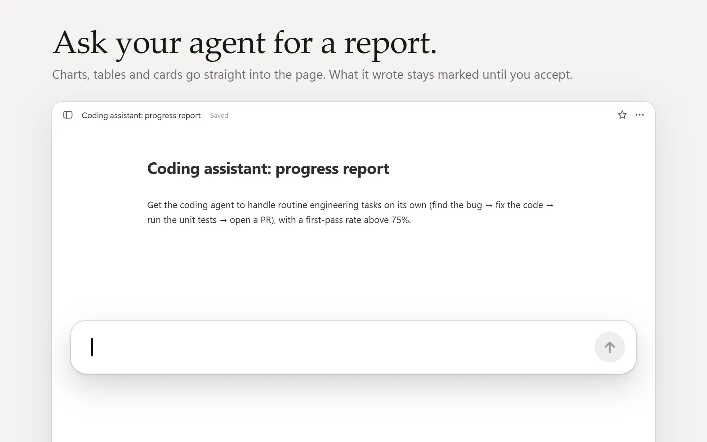
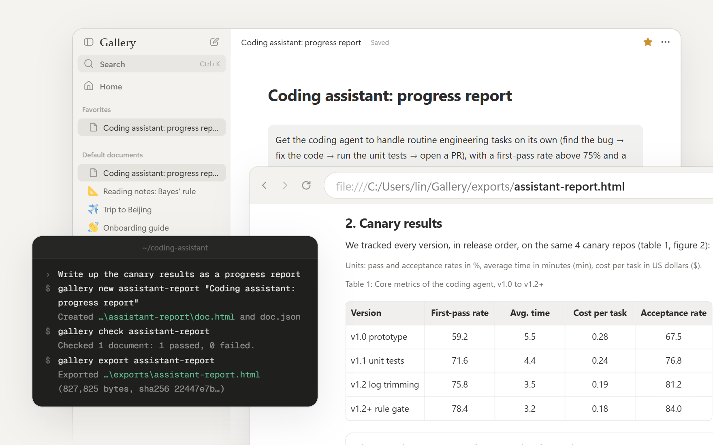
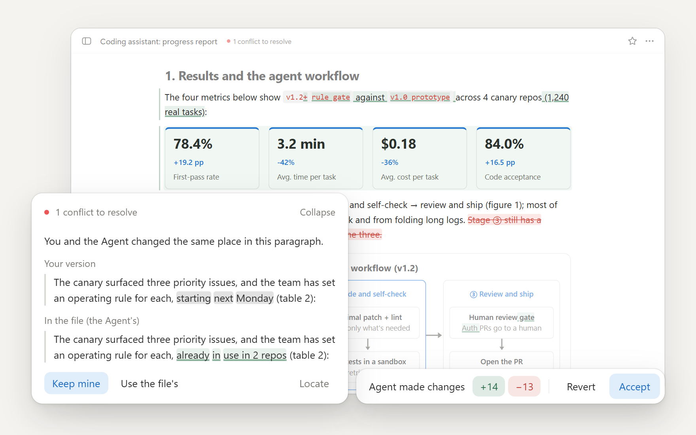
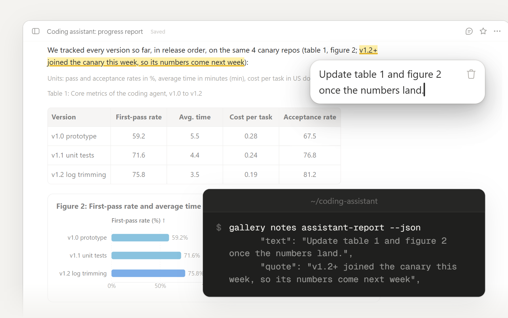
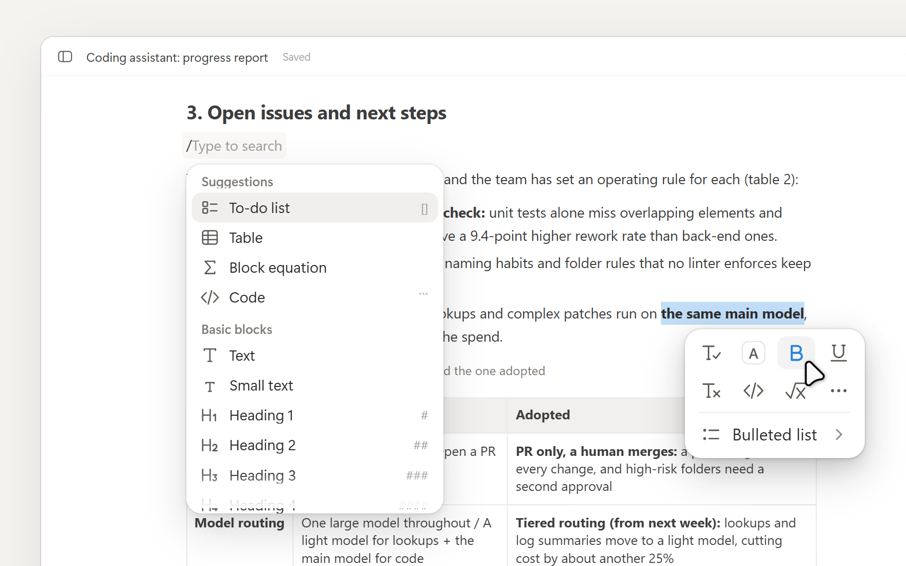
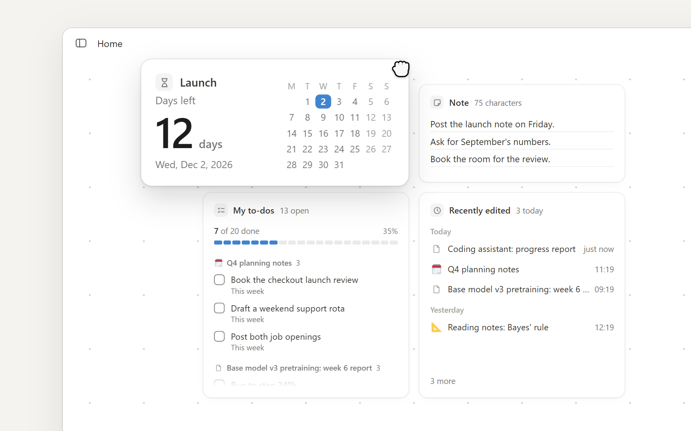

<p align="center">
  <picture>
    <source media="(prefers-color-scheme: dark)" srcset="../../.github/readme/wordmark-dark.png">
    
  </picture>
</p>

<h3 align="center">에이전트와 함께 쓰는 HTML 문서</h3>

<p align="center">
  코딩 에이전트가 쓰는 HTML 문서를 Notion처럼 바로 고칠 수 있는, 내 컴퓨터에서 실행되는 편집기입니다.
</p>

<p align="center">
  <a href="https://www.npmjs.com/package/@heycys/gallery"></a>
  <a href="../../LICENSE"></a>
</p>

<p align="center">
  <a href="../../README.md">English</a> · <a href="README.zh-CN.md">简体中文</a> · <a href="README.zh-TW.md">繁體中文</a> · <a href="README.ja.md">日本語</a> · <b>한국어</b> · <a href="README.es.md">Español</a>
</p>

<p align="center">
  <picture>
    <source media="(prefers-color-scheme: dark)" srcset="../../.github/readme/hero-dark.webp">
    
  </picture>
</p>

<!-- 온라인 데모(배포한 뒤에 추가): <p align="center"><sub><a href="https://heycys.github.io/gallery/">내보낸 문서를 온라인에서 열기</a></sub></p> -->

## 왜 Gallery인가

에이전트에게 문서를 맡기다 보면 자주 부딪히는 문제가 있습니다. **Markdown으로 쓰게** 하면 인터랙티브 차트를 넣을 자리가 없습니다. **HTML로 쓰게** 하면 직접 고치기가 번거롭습니다. **온라인 문서**를 쓰면 로컬 에이전트가 익숙한 파일 도구로 읽고 쓸 수 없습니다.

Gallery는 이렇게 해결합니다.

- 에이전트가 쓰는 HTML 파일 위에 Notion 같은 편집기를 얹습니다.
- 에이전트는 `doc.html`을 직접 쓰고, 사용자는 같은 문서를 Notion에서처럼 편집합니다. 서로 방해하지 않습니다.
- Gallery가 양쪽의 수정을 알아서 합치고, 에이전트가 바꾼 곳을 표시하며, 둘이 충돌하는 곳에서는 사용자의 결정을 기다립니다.
- 문서가 완성되면 누구나 열 수 있는 독립된 HTML 파일(또는 다른 형식)로 내보냅니다.

<p align="center">
  <picture>
    <source media="(prefers-color-scheme: dark)" srcset="../../.github/readme/flow-dark.png">
    
  </picture>
</p>

## 빠른 시작

```bash
npm i -g @heycys/gallery
gallery skill install
```

두 번째 명령은 Gallery 스킬을 Claude Code(`~/.claude/skills/gallery`)와 Codex(`~/.codex/skills/gallery`)에 설치합니다. 둘 중 설치되어 있는 도구에만 넣습니다. 그다음 에이전트에게 이렇게 말하면 됩니다.

> Gallery를 써서 `./research`에 있는 자료와 데이터로 보고서를 만들어 줘. 결론 요약, 비교 표, 추세 차트를 넣어서.

**그다음에는 이렇게 진행됩니다.**

1. 에이전트가 먼저 상시 글쓰기 선호 설정(워크스페이스의 `preferences/`)을 읽고, `gallery new`로 문서를 만든 뒤 로컬 주소를 보내 줍니다.
2. 브라우저에서 페이지를 열어 두면, 에이전트가 저장한 내용이 바로 페이지에 나타납니다. 언제든 글을 쓰거나, 배치를 바꾸거나, 텍스트를 선택해 주석을 남길 수 있습니다.
3. 문서가 완성되면 에이전트가 `gallery export`로 파일 하나를 만들고, `gallery qa`로 결과물의 레이아웃을 직접 점검한 뒤 문서를 건네줍니다.

**다른 시작 방법**

- **스킬을 내려받아 에이전트에게 설치를 맡기기.** [Releases](https://github.com/heycys/gallery/releases)에서 `gallery-skill-<version>.zip`을 내려받아 에이전트에게 보내고, 설치해 달라고 하세요.
- **작업 화면부터 둘러보기.** `gallery open`을 실행하거나, `gallery import ./notes.md`로 이미 있는 문서를 가져오세요(Markdown, Word, PDF, HTML, CSV, EPUB, Notion 내보내기 ZIP).
- **이어서 해 볼 만한 요청:** *"내 주석대로 고치고, 차트 데이터를 업데이트하고, 내가 고친 결론은 그대로 둬."* · *"할 일, 최근 문서, 출시 카운트다운이 있는 홈 페이지를 만들어 줘."*

**요구 사항:** Node.js `22.13` 이상. 데스크톱 **Chrome**, **Microsoft Edge**, **macOS용 Safari**에서 편집할 수 있습니다. `gallery qa`에는 Chrome 또는 Edge가 필요합니다.

## 작동 방식

워크스페이스의 기본 위치는 `~/Documents/Gallery`입니다(`--workspace`나 `GALLERY_WORKSPACE`로 다른 곳을 지정할 수 있습니다). 문서 하나하나는 평범한 폴더입니다.

```text
~/Documents/Gallery/
├── preferences/                # 상시 글쓰기 선호 설정. 에이전트가 글을 쓰기 전에 읽습니다
├── release-review/
│   ├── doc.html                # 문서의 유일한 원본(에이전트, 편집기, Git이 함께 씀)
│   ├── doc.json                # 제목, 설명, 아이콘, 페이지 설정
│   ├── annotations.json        # 텍스트와 블록에 단 주석(문서와 내보낸 파일에는 들어가지 않음)
│   └── assets/                 # 이미지와 첨부 파일
├── components/ & pages/        # 다시 쓸 수 있는 사용자 지정 블록과 캔버스 페이지(홈 페이지도 그중 하나)
└── exports/
    └── release-review.html     # 건네주는 오프라인 HTML 파일 하나
```

`doc.html`은 디스크에 있는 표준 일반 텍스트 HTML이라서 에이전트, Git, 어떤 편집기든 읽고 쓸 수 있습니다. 페이지에서 문장 하나를 고치면 Gallery는 그 문장이 있는 줄만 다시 쓰고 나머지 바이트는 그대로 두므로, `git diff`를 한 줄씩 검토할 수 있습니다. (예외가 하나 있습니다. 에이전트가 일반 HTML로 쓴 표, 토글, 코드, 수식은 문서를 처음 저장하거나 내보낼 때 Gallery의 형식으로 다시 쓰입니다.)

## 기능

### 끊김 없이 동시에 쓰기

에이전트가 파일에 쓰면, 쓴 내용이 페이지의 제자리에 나타납니다. 커서, 선택 영역, 실행 취소 기록은 그대로 남습니다. Gallery는 양쪽의 수정을 블록 단위로 합칩니다.

에이전트가 추가한 내용은 초록색으로, 삭제한 내용은 취소선과 함께 빨간색으로 표시됩니다. 아래쪽 막대의 **Accept**(수락)와 **Revert**(되돌리기)로 에이전트의 수정을 받아들이거나 되돌릴 수 있습니다. **Version history**(버전 기록)에 있는 모든 버전은 복원할 수 있습니다.

<picture>
  <source media="(prefers-color-scheme: dark)" srcset="../../.github/readme/review-dark.png">
  
</picture>

사용자와 에이전트가 같은 곳을 고쳤다면 카드가 나타나 선택하게 합니다. **어떤 글도 사라지지 않습니다.** 에이전트가 예전 사본으로 파일 전체를 다시 써서 방금 저장한 내용을 되돌리는 경우에도 카드가 나타납니다. Gallery는 글자 하나라도 뜻하지 않게 잃어버리지 않도록 최선을 다합니다.

### 주석을 남기고 에이전트에게 넘기기

텍스트나 블록을 선택하고 바꾸고 싶은 내용을 적습니다. 에이전트는 `gallery notes`로 주석을 직접 읽습니다. 주석은 문서 옆의 `annotations.json`에 따로 저장되므로 문서나 내보낸 파일에 섞여 들어가지 않습니다.

<picture>
  <source media="(prefers-color-scheme: dark)" srcset="../../.github/readme/notes-dark.png">
  
</picture>

### HTML의 표현력, Notion 같은 편집

- **바로 쓸 수 있는 블록 편집기:** 드래그 핸들, `/` 메뉴(중국어 입력기에서는 `、`로도 열리며, 글자를 입력해 걸러 볼 수 있습니다), Markdown 단축 입력, 여러 블록에 걸친 선택, Notion과 Feishu에서 바로 붙여넣기.
- **Markdown보다 훨씬 높은 정보 밀도:** 셀 병합과 정렬이 되는 표, KaTeX 수식, Shiki 코드 하이라이트, 토글 목록, 탭, 콜아웃, 상세 카드, 단계 흐름도, 웹 북마크, 임베드가 모두 들어 있습니다.
- **자유로운 그림과 사용자 지정 블록:** 에이전트는 지금 다루는 데이터에 맞춰 D3로 인터랙티브 그림을 그리거나, 특별한 레이아웃이 필요할 때 자체 스타일을 갖춘 사용자 지정 블록을 통째로 쓸 수 있습니다. 페이지에서는 그것도 블록 하나로 옮기고, 안의 글자를 바로 고칠 수 있습니다.

<picture>
  <source media="(prefers-color-scheme: dark)" srcset="../../.github/readme/editing-dark.png">
  
</picture>

### 나만의 홈 페이지 만들기

홈 페이지는 카드를 끌어서 옮기고 크기를 바꿀 수 있는 캔버스입니다. 메모, 할 일, 카운트다운, 습관 트래커, 최근 편집한 문서, 편집 히트맵, 날씨 카드가 있습니다. 없는 카드가 필요하면 에이전트에게 요청하세요. `gallery block`으로 카드를 만들어 주고, `gallery page`로 페이지 전체를 만들어 주기도 합니다. 예를 들면 이렇습니다.

> 홈 페이지에 진행 상황 카드를 하나 만들어 줘. 이번 주 목표 수와 완료한 수를 바로 고칠 수 있게.

<picture>
  <source media="(prefers-color-scheme: dark)" srcset="../../.github/readme/home-dark.png">
  
</picture>

## 자주 쓰는 명령

작업 화면에서 할 수 있는 모든 일(새로 만들기, 이동, 이름 바꾸기, 즐겨찾기, 휴지통, 버전 기록, 주석, 내보내기 등)에는 그에 맞는 `gallery` 명령이 있으므로, 에이전트가 브라우저 자동화로 인터페이스를 클릭할 필요가 없습니다.

| 명령 | 하는 일 |
| --- | --- |
| `gallery open [<slug>]` | 로컬 서버를 시작하고(`127.0.0.1`에서만 연결을 받습니다) 기본 브라우저에서 작업 화면이나 문서 하나를 엽니다 |
| `gallery new <slug> "<title>"` | 문서를 만들고, 로컬 서버를 시작한 뒤 문서 주소를 출력합니다 |
| `gallery import <file>` | Markdown, HTML, Word, PDF, CSV, EPUB 또는 ZIP(Notion 내보내기 포함)을 문서로 바꿉니다 |
| `gallery list [--tree] [--all]` | 워크스페이스의 문서와 트리를 나열하거나 검색합니다(`--json`도 가능) |
| `gallery notes <slug>` | 문서의 주석을 보여 주고, 완료로 표시하거나 지웁니다 |
| `gallery history <slug>` / `revert` | 이전 버전을 보여 주고 그중 하나를 복원하거나, 아직 수락하지 않은 에이전트의 수정을 되돌립니다 |
| `gallery check [<slug>...]` | 문서의 구조, 리소스, 자리 표시자 콘텐츠, 인라인 스크립트를 읽기 전용으로 검사합니다 |
| `gallery export <slug>...` | 마크업을 정규화하고 검사를 실행한 뒤 오프라인 단일 파일 `exports/<slug>.html`을 씁니다(`--format pdf\|markdown`도 가능) |
| `gallery qa <slug>...` | 내보낸 파일을 `1024`, `736`, `360px` 너비로 열어 레이아웃 문제를 보고하고, 바뀐 블록의 스크린샷을 찍습니다 |
| `gallery block` / `gallery page` | 사용자 지정 블록, 블록 팩, 사용자 지정 캔버스 페이지를 만들고, 설치하고, 검사하고, 테스트합니다 |
| `gallery doctor` | Node 버전, 설치된 스킬, 워크스페이스 권한, 로컬 브라우저를 점검합니다 |

모든 옵션은 `gallery help`를 실행하거나 [사용자 매뉴얼](../manual.zh-CN.md)(현재는 중국어)에서 확인하세요.

<details>
<summary><b>그 밖의 기능</b></summary>
<br>

- **Writing preferences**(글쓰기 선호 설정). 에이전트에게 주는 상시 규칙(무엇을, 어떤 순서로 쓸지, 제목을 어떻게 달지)이 워크스페이스에 저장되고, 에이전트는 글을 쓰기 전에 이를 읽습니다.
- **바뀐 곳에 점이 뜹니다.** 지금 보고 있지 않은 페이지를 에이전트가 수정하면 사이드바의 해당 항목 옆에 파란 점이 나타납니다.
- **작업 화면.** 끌어서 하위로 넣는 문서 트리, 즐겨찾기, 전체 텍스트 검색, 휴지통, 여러 워크스페이스, 발표 보기. 라이트 테마와 다크 테마가 있으며, 인터페이스는 영어와 중국어로 되어 있습니다.
- **확장.** 작업 화면에 패널과 설정을 추가할 수 있으며, 확장마다 자체 백엔드를 둘 수 있습니다.

</details>

## 알아 두면 좋은 점

- **내 컴퓨터에서만 실행됩니다.** 서버는 127.0.0.1에서만 연결을 받으므로 이 컴퓨터에서만 접속할 수 있습니다. 계정도 클라우드도 없습니다. 언어 모델을 호출하는 것은 사용자의 에이전트뿐입니다. 북마크, 임베드, 날씨 같은 온라인 카드는 인터넷에 연결되며, 카드는 연결하기 전에 먼저 묻습니다. 또한 `gallery`는 하루에 한 번 백그라운드에서 npm 레지스트리(사용자의 npm이 쓰는 곳)에 새 버전이 있는지 묻습니다. `GALLERY_NO_UPDATE_CHECK=1`로 끌 수 있습니다. Windows나 macOS에 `npm i -g`로 설치하면 로그인할 때 Gallery가 서버를 시작합니다. **Settings**(설정)의 **Start at login**(로그인 시 시작)이나 `gallery startup disable`로 끌 수 있습니다.
- **"함께"는 사용자와 에이전트를 뜻합니다.** Gallery에는 클라우드 동기화도, 다중 사용자 편집도 없습니다. 한 문서는 한 번에 에이전트 하나만 쓰게 하는 것이 좋습니다.
- **문서는 자체 스크립트를 실행합니다.** 직접 썼거나 자신의 에이전트가 쓴 문서만 여세요.
- **지금까지 테스트한 환경:** Windows 11의 Chrome과 Edge, macOS의 Chrome과 Safari(기본 편집 및 저장)입니다. Linux, Firefox, 터치 기기는 테스트하지 않았고, 입력기(IME)로 글자를 입력하는 경우는 시뮬레이션으로만 테스트했습니다.
- **이 페이지의 이미지는** 제품의 실제 페이지를 보여 줍니다. 멈춰 있는 장면은 모두 제품에서 실제로 나타났던 상태이고, 그 사이의 움직임은 한 프레임씩 다시 재생한 것입니다. 창의 배치, 그 위에 겹쳐 놓은 확대 부분, 첫 이미지 시작 부분의 요청 입력 상자, 터미널 창(안의 명령과 출력은 실제입니다), 브라우저 주소 표시줄, 마우스 포인터는 나중에 구성했습니다. 이미지 속 문서와 홈 페이지에는 샘플 데이터가 들어 있습니다.

## 테스트 방법

두 작성자의 수정을 파일 하나로 합치는 부분은 반드시 정확해야 하므로 가장 많이 테스트합니다.

- 실제 Chrome을 조작하는 시나리오가 700개가 넘습니다. 입력기로 입력하는 상황을 시뮬레이션한 것도 포함합니다.
- 사람과 에이전트가 같은 문서를 번갈아 고치는 무작위 테스트를 합니다. 파일과 페이지가 일치해야 하고, 모든 글자는 파일에 남거나 복사할 수 있도록 목록에 올라와야 합니다.
- 버전을 내기 전에 매번, 패키지로 묶은 릴리스를 실제로 설치하고 명령을 하나씩 모두 실행해 봅니다.

## 에이전트용 안내

이 글을 읽고 있는 에이전트라면, [빠른 시작](#빠른-시작)의 명령 두 개로 Gallery를 설치한 다음 [`SKILL.md`](../../skills/gallery/SKILL.md)를 읽고 그대로 따르세요.

## 더 보기

- [사용자 매뉴얼](../manual.zh-CN.md)(현재는 중국어) · [`SKILL.md`](../../skills/gallery/SKILL.md) · [유지 관리자 문서](../internals.md)(영어) · [Releases](https://github.com/heycys/gallery/releases)
- **기여.** 지금 가장 도움이 되는 일은 macOS나 Linux에서, 또는 Safari와 Firefox에서 Gallery를 써 보고 [확인한 내용을 알려 주는 것](https://github.com/heycys/gallery/issues)입니다. 버그를 신고할 때는 OS, 브라우저, Node 버전, Gallery 버전을 함께 적어 주세요. 코드를 고치려면 먼저 [CONTRIBUTING.md](../../.github/CONTRIBUTING.md)(영어)를 읽어 주세요.
- **라이선스.** [MIT](../../LICENSE). 저장소에 들어 있는 다른 사람의 저작물(이모지 그림과 데이터, 아이콘 세트)과 각각의 라이선스는 [THIRD-PARTY-NOTICES.md](../../THIRD-PARTY-NOTICES.md)(영어)에 정리되어 있습니다.
