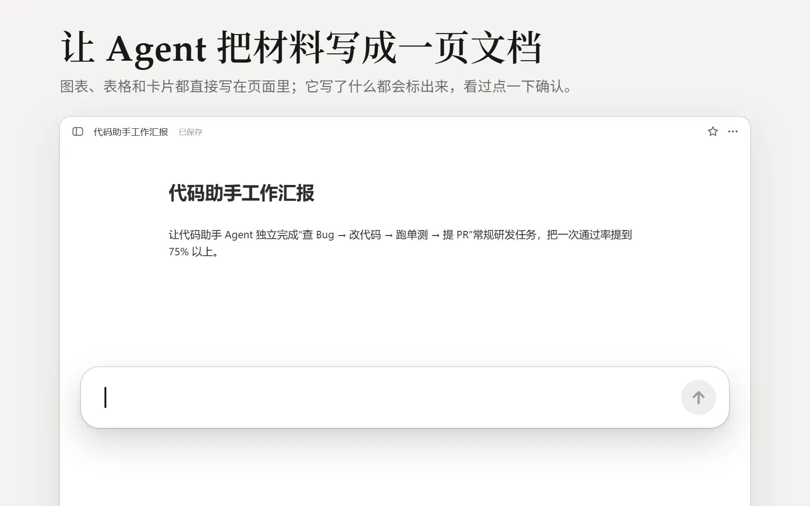
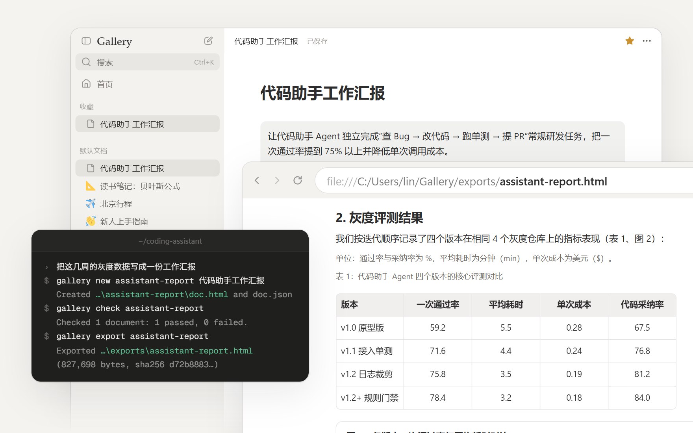
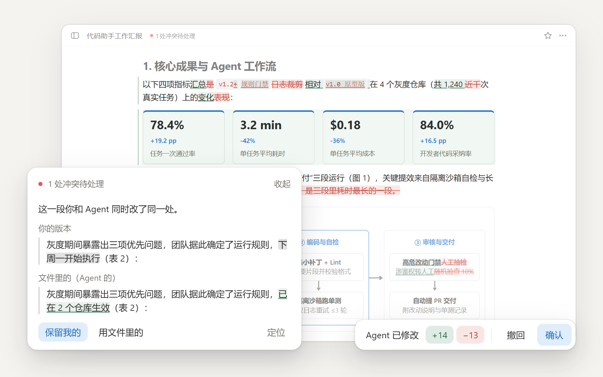
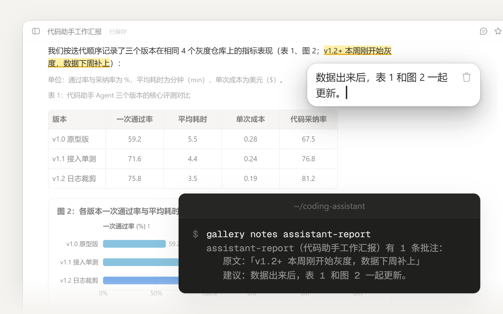
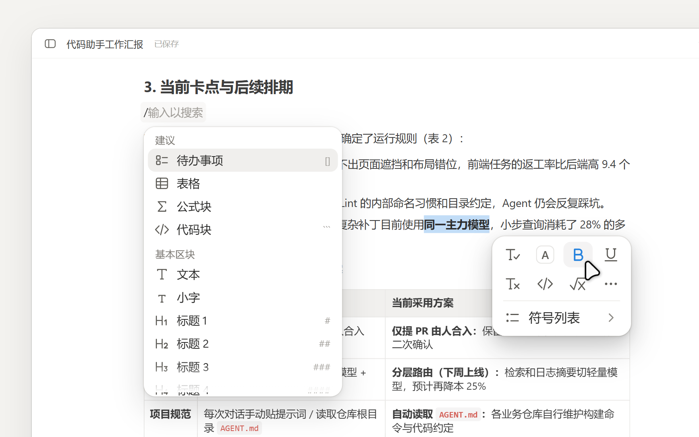
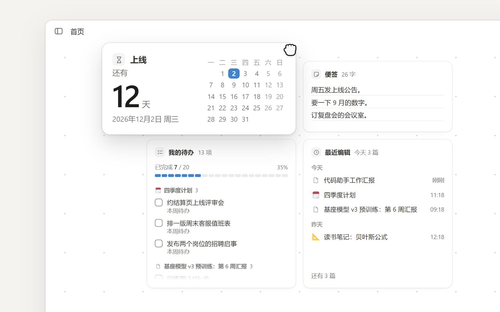

<p align="center">
  <picture>
    <source media="(prefers-color-scheme: dark)" srcset="../../.github/readme/wordmark-dark.png">
    
  </picture>
</p>

<h3 align="center">和 Agent 一起写 HTML 文档</h3>

<p align="center">
  Gallery 是一个在本地运行的文档编辑器：Agent 写 HTML 文档的时候，你能像用 Notion 一样直接修改它。
</p>

<p align="center">
  <a href="https://www.npmjs.com/package/@heycys/gallery"></a>
  <a href="../../LICENSE"></a>
</p>

<p align="center">
  <a href="../../README.md">English</a> · <b>简体中文</b> · <a href="README.zh-TW.md">繁體中文</a> · <a href="README.ja.md">日本語</a> · <a href="README.ko.md">한국어</a> · <a href="README.es.md">Español</a>
</p>

<p align="center">
  <picture>
    <source media="(prefers-color-scheme: dark)" srcset="../../.github/readme/zh/hero-dark.webp">
    
  </picture>
</p>

<!-- 在线演示（部署好之后再加）：<p align="center"><sub><a href="https://heycys.github.io/gallery/">在线打开一份导出成品</a></sub></p> -->

## 为什么做 Gallery

让 Agent 写文档的时候，我们经常会遇到一个问题：让它**写 Markdown**，但放不了交互式图表；让它**写 HTML**，但想自己改一改的时候又很麻烦；使用**在线文档**，本地 Agent 也没法用熟悉的文件工具直接读写。

Gallery 的解决办法是：

- 在 Agent 写的 HTML 文件上加了一个像 Notion 的编辑器。
- 让 Agent 直接写 `doc.html`，同时你也可以像用 Notion 一样编辑它，两者互不冲突。
- Gallery 会自动合并两边的修改，标出 Agent 改了什么，遇到冲突则等你确认。
- 写好后可以导出独立的 HTML 等文件，发给任何人都能看。

<p align="center">
  <picture>
    <source media="(prefers-color-scheme: dark)" srcset="../../.github/readme/zh/flow-dark.png">
    
  </picture>
</p>

## 快速开始

```bash
npm i -g @heycys/gallery
gallery skill install
```

第二条命令会把配套 Skill 装进 Claude Code（`~/.claude/skills/gallery`）和 Codex（`~/.codex/skills/gallery`），你装了哪个就装进哪个。随后你可以对 Agent 直接说：

> 用 Gallery 把 `./research` 里的材料和数据整理成一份报告，包含结论摘要、对比表格和趋势图。

**接下来会发生什么：**

1. Agent 先读取你的长期写作偏好（工作区的 `preferences/`），运行 `gallery new` 创建文档，并把本地预览地址发给你；
2. 浏览器打开页面后，Agent 每保存一次，新内容就直接出现在页面上，你可以随时书写、调版式或选中文字写批注；
3. 写好后，Agent 会运行 `gallery export` 导出单文件，并用 `gallery qa` 自动打开成稿自检排版，最后把文档交给你。

**其他上手方式：**

- **下载 Skill 包让 Agent 安装**：也可以从 [Releases](https://github.com/heycys/gallery/releases) 下载 `gallery-skill-<版本>.zip` 发送给 Agent，让它帮你安装。
- **先自己打开工作台看看**：运行 `gallery open`，或用 `gallery import ./notes.md` 导入现有文档（支持 Markdown、Word、PDF、HTML、CSV、EPUB 及 Notion 导出 ZIP）。
- **继续交给 Agent 的话**：*“照我的批注改一下，更新图表数据，保留我改过的结论”* · *“给我做一个首页，放待办、最近文档和上线倒计时”*。

**要求：** Node.js `22.13` 或更高版本。编辑器支持桌面版 **Chrome**、**Microsoft Edge** 和 **macOS 上的 Safari**。`gallery qa` 需要 Chrome 或 Edge。

## 工作原理

工作区默认位于 `~/Documents/Gallery`（可通过 `--workspace` 或 `GALLERY_WORKSPACE` 指定），每份文档就是一个普通文件夹：

```text
~/Documents/Gallery/
├── preferences/                # 长期写作偏好，Agent 每次动笔前先读
├── release-review/
│   ├── doc.html                # 唯一的正文源文件（Agent、浏览器编辑器、Git 共用）
│   ├── doc.json                # 标题、摘要、图标与版面设置
│   ├── annotations.json        # 你写的行内/块级批注（不进正文与导出文件）
│   └── assets/                 # 图片与附件
├── components/ & pages/        # 可复用的自定义块与画布页（如「首页」）
└── exports/
    └── release-review.html     # 交付用的单文件离线 HTML
```

`doc.html` 是硬盘上标准的纯文本 HTML，Agent、Git 和任何编辑器都能直接读写。你在页面上改一句话，Gallery 只改写文件里对应的那几行，其余字节原封不动，`git diff` 可以逐行审阅。（例外：Agent 用普通 HTML 写的表格、折叠列表、代码和公式，第一次保存或导出时会改写成 Gallery 的写法。）

## 功能详情

### 两边同时写，不中断

Agent 写入文件时，它写的内容就原地出现在页面上。你的光标、选区、撤销记录等都不受影响。Gallery 会逐块合并两边的修改。

Agent 新增的内容用绿色标出，删除的内容带着删除线用红色标出。底部的差异条可以「确认」或「撤回」它的修改。「历史版本」里每一版都可以恢复。

<picture>
  <source media="(prefers-color-scheme: dark)" srcset="../../.github/readme/zh/review-dark.png">
  
</picture>

当双方改到同一处，出现冲突时，会出一张卡片让你选择。**文字不会丢失**。Agent 照着旧内容重写整个文件、把你刚保存的修改改回去时，也会出卡片。Gallery 尽可能让字不会意外丢失。

### 写批注，交回给 Agent

选中文字或一个块，写下要改什么。Agent 自己可以用 `gallery notes` 读取。批注单独存在文档旁边的 `annotations.json` 里，不会混进文档和导出的文件。

<picture>
  <source media="(prefers-color-scheme: dark)" srcset="../../.github/readme/zh/notes-dark.png">
  
</picture>

### 有 HTML 的表现力，同时像 Notion 一样编辑

- **上手即改的块编辑器**：块拖拽把手、`/` 命令菜单（中文输入法下按 `、` 同样呼出，支持字母筛选）、Markdown 快捷输入、跨块选区，支持从 Notion 和飞书直接粘贴。
- **远超 Markdown 的信息密度**：内置支持合并单元格与排序的表格、KaTeX 数学公式、Shiki 代码高亮、折叠列表、选项卡、提示块、详情弹窗、步骤流程图、网页书签与嵌入等组件。
- **自由的图形与定制块**：Agent 可以用 D3 为当前数据单独画交互图，或为特殊版式编写带独立样式的定制整体块，你在页面上依然能整块移动、直接改里面的字。

<picture>
  <source media="(prefers-color-scheme: dark)" srcset="../../.github/readme/zh/editing-dark.png">
  
</picture>

### 自定义自己的首页

首页是一个画布，有可以拖动、调大小的卡片：便签、待办、倒计时、习惯打卡、最近编辑、编辑热图、天气。想要一张没有的卡片，跟 Agent 说，它用 `gallery block` 做一张，或者用 `gallery page` 做一整页。例如：

> 在首页帮我设计一张进度卡片，能直接修改本周目标数和已完成数。

<picture>
  <source media="(prefers-color-scheme: dark)" srcset="../../.github/readme/zh/home-dark.png">
  
</picture>

## 常用命令

工作台界面上的每一个操作（新建、移动、改名、收藏、回收区、历史版本、批注、导出等）都有完全对等的 `gallery` 命令，Agent 全程无需通过浏览器自动化点按界面：

| 命令 | 作用 |
| --- | --- |
| `gallery open [<slug>]` | 启动本机服务（仅监听 `127.0.0.1`），在默认浏览器打开工作台或指定文档 |
| `gallery new <slug> "<标题>"` | 新建文档，启动本机服务并输出预览地址 |
| `gallery import <文件>` | 将 Markdown、HTML、Word、PDF、CSV、EPUB 或 ZIP（含 Notion 导出包）转为文档 |
| `gallery list [--tree] [--all]` | 列出或搜索工作区文档与目录层级（支持 `--json`） |
| `gallery notes <slug>` | 查看、标记完成或清理文档批注 |
| `gallery history <slug>` / `revert` | 查看历史版本、恢复指定快照，或一键撤回未确认的 Agent 修改 |
| `gallery check [<slug>...]` | 只读检查文档结构、资源依赖、占位内容与内联脚本语法 |
| `gallery export <slug>...` | 规范化标记、执行检查并导出离线单文件 `exports/<slug>.html`（支持 `--format pdf\|markdown`） |
| `gallery qa <slug>...` | 按 `1024`、`736`、`360px` 三种宽度打开导出文件，报告排版问题并为改动块截图 |
| `gallery block` / `gallery page` | 创建、安装、检查和测试自定义块、块包与自定义画布页 |
| `gallery doctor` | 检查 Node 版本、Skill 配套状态、工作区读写权限与本机浏览器环境 |

完整参数列表可运行 `gallery help` 或查阅[使用手册](../manual.zh-CN.md)。

<details>
<summary><b>还有这些</b></summary>
<br>

- **写作偏好。** 你给 Agent 的长期写作要求（写什么、按什么顺序、标题怎么起）存在工作区里，Agent 每次动笔前先读。
- **有更新就亮个点。** Agent 改了你没在看的页面，侧栏里那一行会亮一个蓝点。
- **工作台。** 文档树（拖动调整层级）、收藏、全文搜索、回收区、多个工作区、演示视图。浅色和深色主题；界面有中文和英文。
- **扩展。** 给工作台加栏目和设置开关，可以带自己的后台。

</details>

## 需要知道的

- **只在你的电脑上运行**：服务监听 127.0.0.1，只有这台电脑能访问。没有账号，没有云端；调用大模型的只有你自己的 Agent。网页书签、嵌入和天气这类联网卡片要联网，卡片会先问你。`gallery` 每天会在后台向 npm 源（你的 npm 用的那个）问一次有没有新版本，设 `GALLERY_NO_UPDATE_CHECK=1` 就不问。在 Windows、macOS 上用 `npm i -g` 装的 Gallery，登录系统后会在后台启动服务，在「设置」里关掉「开机自启动」或运行 `gallery startup disable` 就不启动。
- **“一起写”指的是你和 Agent**：Gallery 没有云同步，也没有多人协作。同一时间只让一个 Agent 写一份文档。
- **文档会运行自己的脚本**：只打开你自己或你的 Agent 写的文档。
- **目前测过的：** Windows 11 上的 Chrome 和 Edge，macOS 上的 Chrome 和 Safari（基本编辑与保存）。Linux、Firefox 和触屏设备都没测过；中文输入法只做过模拟测试。
- **这一页上的图**里，产品的画面取自真实的页面：每个停下来的画面都是产品里真实出现过的状态，中间的动作按帧重放。窗口怎么摆、叠在上面的放大部分、主图开头的输入框、终端窗口（里面的命令和输出是真的）、浏览器的地址栏和鼠标指针是后做的。图里的文档和首页用的是示例数据。

## 怎么测的

人和 Agent 写同一个文件、合并不出错，是最要紧的部分，所以测得最多：

- 700 多个在真实 Chrome 里操作页面的场景，包括模拟中文输入法；
- 随机测试：人和 Agent 轮流随机改同一份文档，检查文件和页面一致，双方写的每个字要么在文件里，要么被列出来给你复制；
- 每次发布前，把打好的包装一遍，每个命令跑一次。

## 写给 Agent

如果你是正在读这份说明的 Agent：用[快速开始](#快速开始)里的两条命令安装 Gallery，然后读 [`SKILL.md`](../../skills/gallery/SKILL.md)，照它做。

## 更多

- [使用手册](../manual.zh-CN.md) · [`SKILL.md`](../../skills/gallery/SKILL.md) · [维护者文档](../internals.md)（英文） · [Releases](https://github.com/heycys/gallery/releases)
- **参与。** 现在最有用的是在 macOS、Linux 上，或用 Safari、Firefox 试一试，[把看到的告诉我们](https://github.com/heycys/gallery/issues)。报问题时请写上系统、浏览器、Node 版本和 Gallery 版本。想改代码的话，先看 [CONTRIBUTING.md](../../.github/CONTRIBUTING.md)（英文）。
- **许可证。** [MIT](../../LICENSE)。仓库里别人的作品（表情图片和数据、图标集）和各自的许可证列在 [THIRD-PARTY-NOTICES.md](../../THIRD-PARTY-NOTICES.md)（英文）。
