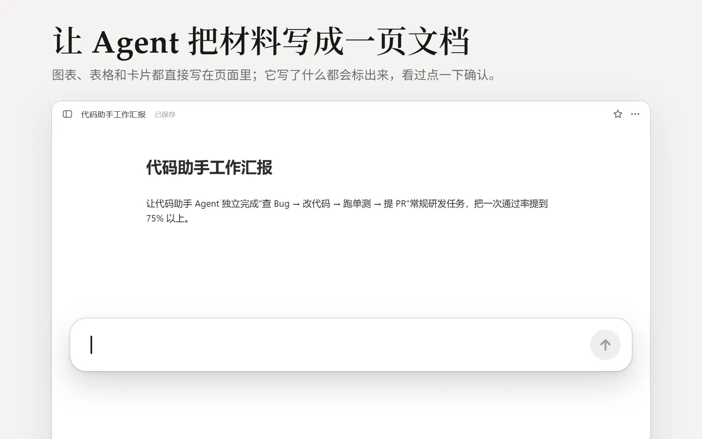
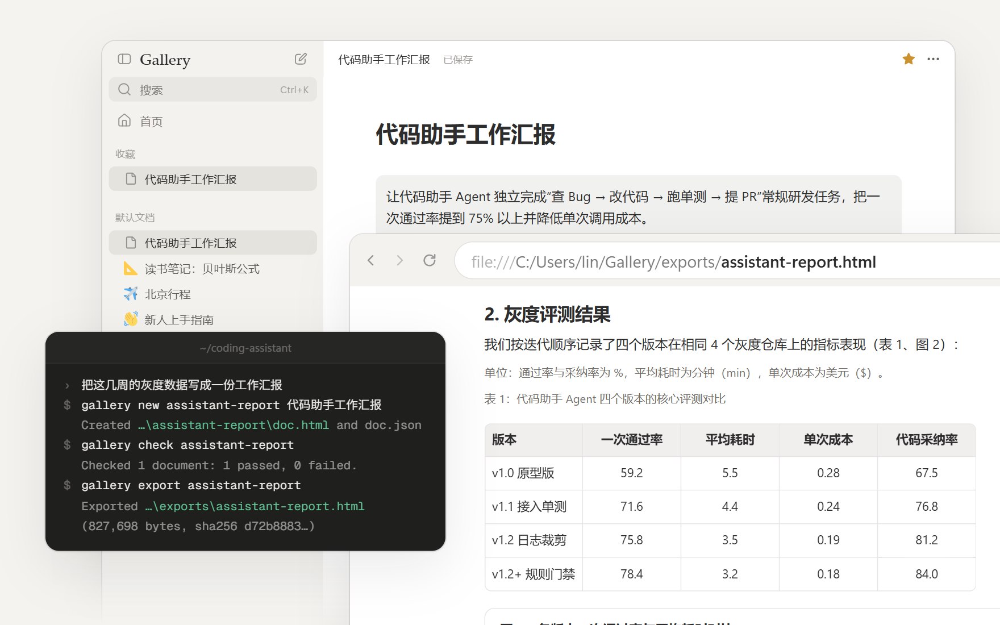
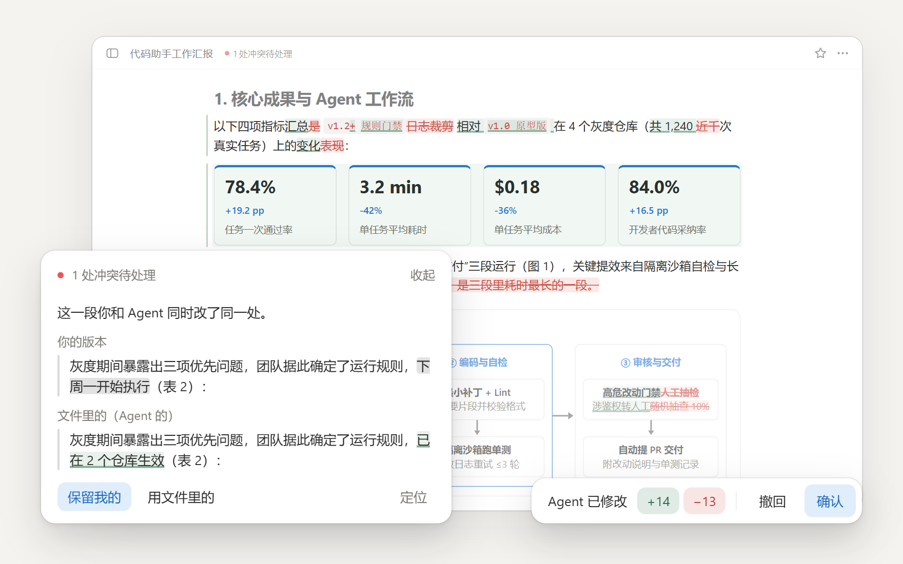
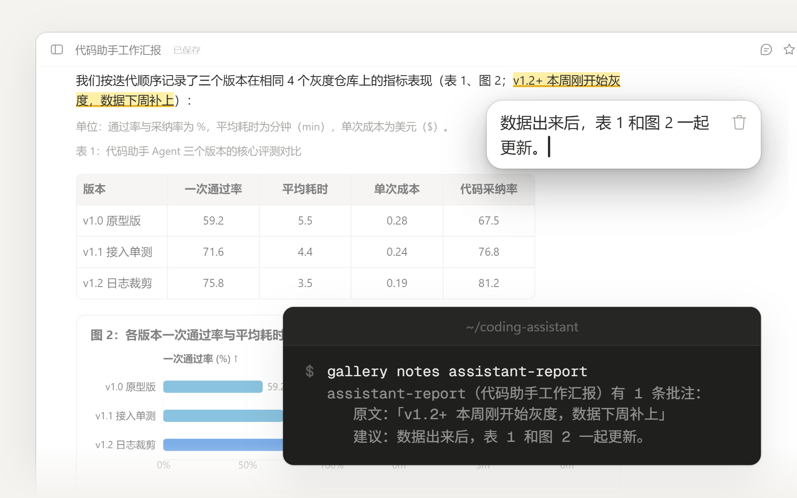
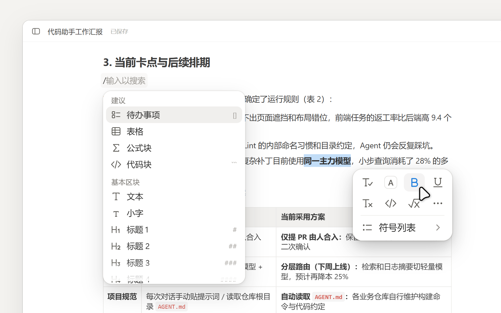
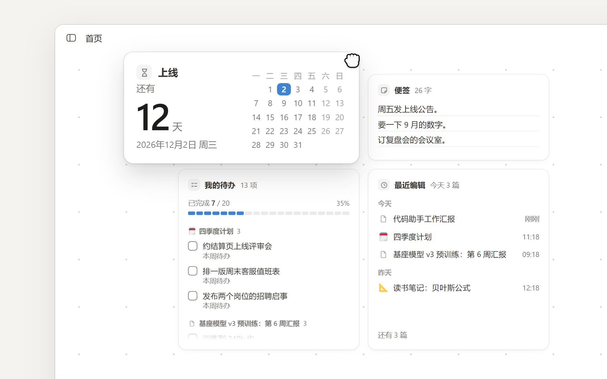

<p align="center">
  <picture>
    <source media="(prefers-color-scheme: dark)" srcset="../../.github/readme/wordmark-dark.png">
    
  </picture>
</p>

<h3 align="center">和 Agent 一起寫 HTML 文件</h3>

<p align="center">
  Gallery 是一個在本機執行的文件編輯器：Agent 寫 HTML 文件的時候，你能像用 Notion 一樣直接修改它。
</p>

<p align="center">
  <a href="https://www.npmjs.com/package/@heycys/gallery"></a>
  <a href="../../LICENSE"></a>
</p>

<p align="center">
  <a href="../../README.md">English</a> · <a href="README.zh-CN.md">简体中文</a> · <b>繁體中文</b> · <a href="README.ja.md">日本語</a> · <a href="README.ko.md">한국어</a> · <a href="README.es.md">Español</a>
</p>

<p align="center">
  <picture>
    <source media="(prefers-color-scheme: dark)" srcset="../../.github/readme/zh/hero-dark.webp">
    
  </picture>
</p>

<!-- 線上示範（部署好之後再加）：<p align="center"><sub><a href="https://heycys.github.io/gallery/">在線上開啟一份匯出的成品</a></sub></p> -->

## 為什麼做 Gallery

讓 Agent 寫文件的時候，我們常常會遇到一個問題：讓它**寫 Markdown**，但放不了互動式圖表；讓它**寫 HTML**，但想自己改一改的時候又很麻煩；使用**線上文件**，本機的 Agent 又沒辦法用熟悉的檔案工具直接讀寫。

Gallery 的解決辦法是：

- 在 Agent 寫的 HTML 檔案上加了一個像 Notion 的編輯器。
- 讓 Agent 直接寫 `doc.html`，同時你也可以像用 Notion 一樣編輯它，兩者互不衝突。
- Gallery 會自動合併兩邊的修改，標出 Agent 改了什麼，遇到衝突則等你確認。
- 寫好後可以匯出獨立的 HTML 等檔案，傳給任何人都能看。

<p align="center">
  <picture>
    <source media="(prefers-color-scheme: dark)" srcset="../../.github/readme/zh/flow-dark.png">
    
  </picture>
</p>

## 快速開始

```bash
npm i -g @heycys/gallery
gallery skill install
```

第二行指令會把配套的 Skill 裝進 Claude Code（`~/.claude/skills/gallery`）和 Codex（`~/.codex/skills/gallery`），你裝了哪一個就裝進哪一個。接著你可以直接對 Agent 說：

> 用 Gallery 把 `./research` 裡的資料和數據整理成一份報告，包含結論摘要、比較表格和趨勢圖。

**接下來會發生什麼：**

1. Agent 先讀取你的長期寫作偏好（工作區的 `preferences/`），執行 `gallery new` 建立文件，並把本機預覽網址傳給你；
2. 瀏覽器開啟頁面後，Agent 每儲存一次，新內容就直接出現在頁面上，你可以隨時書寫、調整版面，或選取文字寫批註；
3. 寫好後，Agent 會執行 `gallery export` 匯出單一檔案，並用 `gallery qa` 自動開啟完稿、自行檢查排版，最後把文件交給你。

**其他上手方式：**

- **下載 Skill 套件讓 Agent 安裝**：也可以從 [Releases](https://github.com/heycys/gallery/releases) 下載 `gallery-skill-<版本>.zip` 傳給 Agent，讓它幫你安裝。
- **先自己開啟工作台看看**：執行 `gallery open`，或用 `gallery import ./notes.md` 匯入現有的文件（支援 Markdown、Word、PDF、HTML、CSV、EPUB 及 Notion 匯出的 ZIP）。
- **接著交給 Agent 的話**：*「照我的批註改一下，更新圖表數據，保留我改過的結論」* · *「幫我做一個首頁，放待辦、最近的文件和上線倒數計時」*。

**需求：** Node.js `22.13` 或更高版本。在瀏覽器中編輯與執行 `gallery qa` 需要桌面版 **Chrome** 或 **Microsoft Edge**（其他瀏覽器未測試；目前已在 Windows 11 和 macOS 27 上完成驗證）。

## 運作原理

工作區預設位於 `~/Documents/Gallery`（可用 `--workspace` 或 `GALLERY_WORKSPACE` 指定），每份文件就是一個普通的資料夾：

```text
~/Documents/Gallery/
├── preferences/                # 長期寫作偏好，Agent 每次動筆前先讀
├── release-review/
│   ├── doc.html                # 唯一的內文原始檔（Agent、瀏覽器編輯器、Git 共用）
│   ├── doc.json                # 標題、摘要、圖示與版面設定
│   ├── annotations.json        # 你寫的行內/區塊批註（不進內文與匯出檔案）
│   └── assets/                 # 圖片與附件
├── components/ & pages/        # 可重複使用的自訂區塊與畫布頁（如「首頁」）
└── exports/
    └── release-review.html     # 交付用的單一離線 HTML 檔案
```

`doc.html` 是硬碟上標準的純文字 HTML，Agent、Git 和任何編輯器都能直接讀寫。你在頁面上改一句話，Gallery 只改寫檔案裡對應的那幾行，其餘位元組原封不動，`git diff` 可以逐行審閱。（例外：Agent 用普通 HTML 寫的表格、摺疊清單、程式碼和公式，第一次儲存或匯出時會改寫成 Gallery 的寫法。）

## 功能詳情

### 兩邊同時寫，不中斷

Agent 寫入檔案時，它寫的內容就原地出現在頁面上。你的游標、選取範圍、復原記錄等都不受影響。Gallery 會逐區塊合併兩邊的修改。

Agent 新增的內容用綠色標出，刪除的內容帶著刪除線用紅色標出。底部的差異列可以「確認」或「撤回」它的修改。「歷史版本」裡每一版都可以還原。

<picture>
  <source media="(prefers-color-scheme: dark)" srcset="../../.github/readme/zh/review-dark.png">
  
</picture>

當雙方改到同一處、出現衝突時，會跳出一張卡片讓你選擇。**文字不會遺失**。Agent 照著舊內容重寫整個檔案、把你剛儲存的修改改回去時，也會跳出卡片。Gallery 盡可能讓字不會意外遺失。

### 寫批註，交回給 Agent

選取文字或一個區塊，寫下要改什麼。Agent 自己可以用 `gallery notes` 讀取。批註單獨存在文件旁邊的 `annotations.json` 裡，不會混進文件和匯出的檔案。

<picture>
  <source media="(prefers-color-scheme: dark)" srcset="../../.github/readme/zh/notes-dark.png">
  
</picture>

### 有 HTML 的表現力，同時像 Notion 一樣編輯

- **上手即改的區塊編輯器**：區塊拖曳把手、`/` 指令選單（拼音輸入法下按出的 `、` 同樣能叫出，支援字母篩選）、Markdown 捷徑、跨區塊選取，支援從 Notion 和飛書直接貼上。
- **遠超 Markdown 的資訊密度**：內建支援合併儲存格與排序的表格、KaTeX 數學公式、Shiki 程式碼語法突顯、摺疊清單、頁籤、提示區塊、詳情彈出視窗、步驟流程圖、網頁書籤與嵌入等元件。
- **自由的圖形與自訂區塊**：Agent 可以用 D3 為當前的數據單獨畫互動圖，或為特殊版面撰寫帶獨立樣式的自訂整體區塊，你在頁面上依然能整塊移動、直接改裡面的字。

<picture>
  <source media="(prefers-color-scheme: dark)" srcset="../../.github/readme/zh/editing-dark.png">
  
</picture>

### 自訂自己的首頁

首頁是一張畫布，上面有可以拖曳、調整大小的卡片：便利貼、待辦、倒數計時、習慣打卡、最近編輯、編輯熱力圖、天氣。想要一張沒有的卡片，跟 Agent 說，它用 `gallery block` 做一張，或者用 `gallery page` 做一整頁。例如：

> 在首頁幫我設計一張進度卡片，能直接修改本週目標數和已完成數。

<picture>
  <source media="(prefers-color-scheme: dark)" srcset="../../.github/readme/zh/home-dark.png">
  
</picture>

## 常用指令

工作台介面上的每一個操作（新增、移動、重新命名、加入收藏、回收區、歷史版本、批註、匯出等）都有完全對等的 `gallery` 指令，Agent 全程不必透過瀏覽器自動化去點按介面：

| 指令 | 用途 |
| --- | --- |
| `gallery open [<slug>]` | 啟動本機服務（只監聽 `127.0.0.1`），在預設瀏覽器開啟工作台或指定的文件 |
| `gallery new <slug> "<標題>"` | 建立文件，啟動本機服務並輸出預覽網址 |
| `gallery import <檔案>` | 把 Markdown、HTML、Word、PDF、CSV、EPUB 或 ZIP（含 Notion 匯出檔）轉成文件 |
| `gallery list [--tree] [--all]` | 列出或搜尋工作區的文件與目錄階層（支援 `--json`） |
| `gallery notes <slug>` | 查看、標記完成或清除文件的批註 |
| `gallery history <slug>` / `revert` | 查看歷史版本、還原指定的快照，或一鍵撤回尚未確認的 Agent 修改 |
| `gallery check [<slug>...]` | 唯讀檢查文件結構、資源相依性、預留位置內容與內嵌指令碼的語法 |
| `gallery export <slug>...` | 正規化標記、執行檢查並匯出離線的單一檔案 `exports/<slug>.html`（支援 `--format pdf\|markdown`） |
| `gallery qa <slug>...` | 依 `1024`、`736`、`360px` 三種寬度開啟匯出的檔案，回報排版問題並為改動的區塊截圖 |
| `gallery block` / `gallery page` | 建立、安裝、檢查和測試自訂區塊、區塊套件與自訂畫布頁 |
| `gallery doctor` | 檢查 Node 版本、Skill 配套狀態、工作區讀寫權限與本機瀏覽器環境 |

完整的參數列表可以執行 `gallery help`，或查閱[使用手冊](../manual.zh-CN.md)（簡體中文）。

<details>
<summary><b>還有這些</b></summary>
<br>

- **寫作偏好。** 你給 Agent 的長期寫作要求（寫什麼、依什麼順序、標題怎麼取）存在工作區裡，Agent 每次動筆前先讀。
- **有更新就亮個點。** Agent 改了你沒在看的頁面，側邊欄裡那一行會亮一個藍點。
- **工作台。** 文件樹（拖曳調整層級）、收藏、全文搜尋、回收區、多個工作區、演示檢視。淺色和深色主題；介面有中文和英文，其中中文介面為簡體中文。
- **擴充功能。** 給工作台加面板和設定開關，可以帶自己的後端。

</details>

## 使用須知

- **只在你的電腦上執行**：服務監聽 127.0.0.1，只有這台電腦能連線。沒有帳號，沒有雲端；呼叫大型語言模型的只有你自己的 Agent。網頁書籤、嵌入和天氣這類連網的卡片需要連上網路，卡片會先問你。`gallery` 每天會在背景向 npm 的套件來源（你的 npm 用的那個）詢問一次有沒有新版本，設定 `GALLERY_NO_UPDATE_CHECK=1` 就不會詢問。在 Windows、macOS 上用 `npm i -g` 安裝的 Gallery，登入系統後會在背景啟動服務，在「設定」裡關掉「開機自啟動」或執行 `gallery startup disable` 就不會啟動。
- **「一起寫」指的是你和 Agent**：Gallery 沒有雲端同步，也沒有多人協作。同一時間只讓一個 Agent 寫一份文件。
- **文件會執行自己的指令碼**：只開啟你自己或你的 Agent 寫的文件。
- **目前測試過的：** Windows 11 上的 Chrome 和 Edge，macOS 27 上的 Chrome。Linux、Safari、Firefox 和觸控裝置都沒測試過；中文輸入法只做過模擬測試。
- **這一頁上的圖**裡，產品的畫面取自真實的頁面：每個停下來的畫面都是產品裡真實出現過的狀態，中間的動作逐格重播。視窗怎麼擺、疊在上面的放大部分、主圖開頭的輸入框、終端機視窗（裡面的指令和輸出是真的）、瀏覽器的網址列和滑鼠指標，是後來加上的。圖裡的文件和首頁用的是範例資料。

## 怎麼測試的

人和 Agent 寫同一個檔案、合併不出錯，是最要緊的部分，所以測得最多：

- 700 多個在真實 Chrome 裡操作頁面的場景，包括模擬中文輸入法；
- 隨機測試：人和 Agent 輪流隨機改同一份文件，檢查檔案和頁面一致，雙方寫的每個字不是在檔案裡，就是被列出來讓你複製；
- 每次發布前，把打包好的套件安裝一遍，每個指令各執行一次。

## 寫給 Agent

如果你是正在讀這份說明的 Agent：用[快速開始](#快速開始)裡的兩行指令安裝 Gallery，然後讀 [`SKILL.md`](../../skills/gallery/SKILL.md)，照著做。

## 更多

- [使用手冊](../manual.zh-CN.md)（簡體中文） · [`SKILL.md`](../../skills/gallery/SKILL.md) · [維護者文件](../internals.md)（英文） · [Releases](https://github.com/heycys/gallery/releases)
- **參與。** 現在最有用的是在 macOS、Linux 上，或用 Safari、Firefox 試一試，[把看到的告訴我們](https://github.com/heycys/gallery/issues)。回報問題時請寫上作業系統、瀏覽器、Node 版本和 Gallery 版本。想修改程式碼的話，先看 [CONTRIBUTING.md](../../.github/CONTRIBUTING.md)（英文）。
- **授權條款。** [MIT](../../LICENSE)。儲存庫裡他人的作品（表情圖片和資料、圖示集）和各自的授權條款列在 [THIRD-PARTY-NOTICES.md](../../THIRD-PARTY-NOTICES.md)（英文）。
